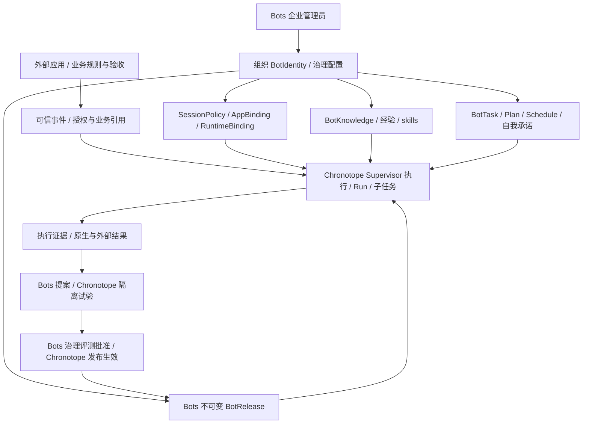

# 持久 Agent 身份、跨渠道协作与非模型 RSI 设计

> MVP 裁剪（2026-10-19）：本文是能力边界与后续设计，不是全部前置清单。Chronotope 未上生产，Bots 从空目录起步；当前以[期 8 G0/G1/G2](./期8-细化落地方案.md)为准，只做一个 Bot/Slack/模型、简单知识和提醒 Task、durable timer 与 receipt。多 Agent、完整原生对象拆分、自动 RSI/三套大型评测/灰度发布及兼容迁移均后置。普通学习/任务能力先验收，完整 I 系列不阻塞 G1。

> 2026-10-18。源码基线：`9d14760`。状态：**设计待实施**，不表示已具备自动改进能力。
> 本文将 RSI 定义为受约束的递归自我改进：固定评测中的模型与环境，通过反馈改进 Bot 自身的 harness、context/memory policy、skills 和 loop/SOP 实现；不修改模型权重、外部业务规则或业务完成口径。
> 关联：[期 8 细化落地方案](./期8-细化落地方案.md)、[多 Agent 协作横评](./调研-多Agent持久协作方案横评.md)、[承诺原语](./承诺原语设计.md)。

> 定位修订（2026-10-19）：Bots 管理组织所有的 Bot 及其人格、治理策略、应用账号、loop/SOP 和原生知识/任务能力。成员交互在外部 Slack/GitHub/Linear 等应用发生；源应用事实、权限规则及其 issue/订单/contract 等对象仍由对应系统负责。Bot 可以内化业务知识，自主规划、提醒、研究并履行自己的行动承诺，不要求先创建外部业务对象。Chronotope 提供通用耐久机制；三方边界见[职责边界](./Chronotope与Bingdi-Bots职责边界.md)。下文均为待实施设计。

## 1. 产品与运行时目标

Bot 是组织/团队持续使用的受治理主体，能够形成自己的知识、经验、计划与任务，并在授权范围内自主跟进。Bots 登记身份、配置和改进版本，原生能力负责 BotKnowledge、BotTask/Plan/Schedule 及自我承诺的语义；其数据可以存于 Bots 或 Chronotope 的通用存储，物理位置不改变 owner。Chronotope 提供技术 agent/session/run、等待和调度等耐久执行。

成员在外部应用与 Bot 协作，控制台不另建成员聊天 UI 或替代源应用的工单/合同产品；这不限制 Bot 自建研究、报告、提醒等原生任务。DM 是同一组织 Bot 的 session/context 策略，不产生个人所有的 Bot，也不自动取得其他来源权限。



三条连续性分别验证：组织 Bot 身份跨应用和进程不变；自身知识、原生任务/自我承诺以及外部对象引用跨 session 可追踪；改进经证据进入后续运行。使用同一 Bot 不自动共享所有 DM、私有数据、账号或执行权限，管理员的治理配置也不能覆盖外部业务拒绝。

## 2. 持久身份与运行版本

### 2.1 稳定与可变部分

| 对象 | 生命周期与含义 |
|---|---|
| BotIdentity（Bots） | tenant/组织/团队下稳定 `bot_id`，记录管理组织、管理员与配置状态；不以成员个人、渠道、模型或 runtime ID 为身份根 |
| RuntimeAgentRef（Chronotope） | 技术注册 `agent_id` 与执行配置地址，通过版本化 BotRuntimeBinding 关联产品身份 |
| AgentProfileRevision | 组织配置的展示名、人格、角色、工作方式与 SOP 引用；保留历史，不能改外部授权根或业务规则 |
| AppBinding（Bots） | 外部应用/installation、账号与凭据引用、技术 adapter、唯一 dispatch owner、业务 policy/验收合同引用及能力范围 |
| ChannelBinding / SessionPolicy（Bots） | 外部地址到 Bot/profile/runtime 的关联，配置 DM/频道/线程的上下文、治理准入与回复策略；不持有外部 conversation 真相 |
| AgentSession | 同一组织 Bot 在外部会话或原生工作 scope 中的技术 session；按 SessionPolicy 分配私态，执行/邮箱状态归 Chronotope，不要求每个内部任务都有外部 thread |
| ExecutionIdentity | 实际使用的应用账号或外部应用授权的委托身份；治理允许使用某账号不等于该账号通过了某项业务资格检查 |
| Bot 原生能力 | Bot-owned 的知识、任务、计划、日程和自我承诺；自行维护有版本的内容/完成契约，复用通用存储与耐久执行，不要求外部 issue/calendar 先存在 |
| Activation / Run | 有限执行回合，绑定 release、上下文来源和当前作用域，跨重启按自身合同恢复 |

同一组织/tenant 可将多个应用 workspace 与渠道绑定到同一 Bot。跨组织的同名 Bot 默认是不同主体；如需联合身份，须另有显式联邦/委派合同。克隆为独立主体产生新 BotID；成员私聊、候选发布或 infra 技术注册重建不是身份克隆。

Bots 持有 BotID 及 `BotRuntimeBinding(bot_id, runtime_provider, runtime_agent_id, role, binding_version)` 历史；Chronotope 的 `agents.id/org_id` 只作技术注册权威。迁移不改变 BotID，但既有命令/attempt 的重试、查询和 unknown 对账走原 owner，跨 provider 另做排空/交接；同 operation ID 不等于共享幂等账本。

外部人类账号通过 `ExternalIdentityLink(tenant, issuer/installation_namespace, subject, principal_ref, evidence, version)` 关联；关联需可信身份源证据或有权管理决议。显示名、头像或未经验证的邮箱相同不能自动合并；证明是同一成员不使其成为 Bot owner，也不继承另一渠道的私聊、凭据和业务授权。

源事件冻结接纳时的 principal 与 mapping revision。解绑/重绑不追溯改写历史作者，不把旧审批或任务权限转交给新关联主体；新动作仍检查当前关联与授权。

### 2.2 BotRelease 与 RuntimeSpecRevision

```text
BotRelease = { // 内容与批准归 Bots
  bot_id, release_id, base_release_id, manifest_digest,
  profile_revision, governance_policy_ref, harness_artifact_ref, tool_schema_manifest,
  skills_hooks_manifest, context_policy_ref, memory_policy_ref,
  loop_sop_ref, external_business_contract_refs, evaluation_ref, runtime_spec_ref
}

RuntimeSpecRevision = { // 技术注册、校验与运行绑定归 Chronotope
  runtime_agent_id, spec_revision, artifact_digests,
  protocol_and_resource_config, compatibility_ref, opaque_bot_release_ref
}
```

- 引用指向不可变版本/digest；路由或 active 指针可变，已发布 manifest 不可被同名覆盖。
- 每次接纳 run 绑定技术 spec 与 BotRelease/binding 引用；Bots 决定治理 rollout，Chronotope 执行实际版本选择与绑定，在途 run 保持自身 bound。替换 harness 不更换 BotID，也不重建原生任务/自我承诺或外部对象。
- memory/plan policy 是 Bot 学习和工作的程序版本；BotKnowledge、BotTask/Plan/Schedule 与自我承诺各有内容修订/事务权威，不随 release 任意回滚。外部事实与对象状态仍按源应用合同生效。日常知识写入、建任务或设提醒不需要每次发布一个 BotRelease。
- external business contract refs 标识外部能力和规则版本。相关规则、名单和判据可以成为有来源的 Bot 知识、缓存及推理材料，但不是替代源应用当前授权/真相的本地权威；治理可加更窄限制，不能把外部拒绝改为允许。
- 旧 release 不保留被撤销权限。新派发、凭据签发、读取和公开输出都按当前授权/epoch 重验。
- release 回滚只改变未来选择；已发生的外部效果、已确认的承诺、事实纠错、删除和撤权分别按各自合同处理，不能跟随代码回滚而消失或复活。

### 2.3 上下文身份与执行资源分别绑定

Bot、persona、session 和 child 的上下文身份不等于 workspace、文件系统或凭据隔离。不可变技术 spec 声明可用资源和隔离策略；每次 run/child 接纳再冻结实际 `ExecutionResourceBinding(session_or_child_ref, environment_ref, workspace_ref, credential_grant_refs, isolation_mode, binding_revision)`，声明哪些资源共享、哪些独立及其作用域，不把动态 session/租约写成全局 spec 的可变内容。独立 child context 不能被描述为已经获得独立沙箱或最小凭据。

Bots 管理可使用的应用账号、治理能力范围及资源共享配置；外部应用仍决定实际业务委托和访问授权。Chronotope 根据受信 binding 管理技术资源、租约与授权执行。provider 只能提供共享文件系统或继承工具凭据时，应显式声明并按能力限制接纳，不得把 persona、session 或 child ID 当成资源隔离证明。DM 只收窄 session/context 可见性，不自动授予个人连接器或其他业务账号。

## 3. Channel Adapter 合同

Bots 可管理通用接入 adapter、installation、应用账号和技术身份映射；外部应用或其领域服务拥有 conversation/message、业务任务、规则及验收。业务交互留在外部应用，adapter 的验签、映射和转发不使 Bots 成为业务真相源。Chronotope 消费通用 envelope、凭据/授权引用和工具调用合同，不解释 Slack thread 或业务资格。

AppBinding 明确每次发送/工具操作的唯一技术 dispatch owner：可以是直接调用 Slack 等 API 的 Bots adapter，也可以是外部 bridge。该 owner 负责派发状态、provider receipt、unknown 对账和当前授权检查；外部平台仍是消息/thread 的源真相。不能要求所有 sender 都部署在外部，也不能因 Bots 保存发送回执就把业务验收权交给 Bots。

### 3.1 能力声明

`ChannelAdapterDescriptor` 至少声明：入站方式、验证方式、ACK 机制与期限、源事件 ID/顺序语义、补读覆盖范围、thread/mention/edit/delete/附件能力、发送限制，以及出站幂等/回执/查询能力。

```text
VerifyAndNormalize(installation, raw) → NormalizedEvent | rejected
ReadAfter(binding, source_cursor)
  → events + next_cursor + coverage_boundary + complete/gap/expired | unsupported
Acknowledge(source_receipt, durable_admission)
Send/Edit/Delete(reply_intent, execution_grant)
  → receipt | not_accepted(reason, retryability, retry_after) | unknown | unsupported
Reconcile(operation_id, provider_ref) → confirmed | not_accepted | unknown | unsupported
```

统一接口允许能力缺失。没有线程的渠道使用自己的会话关联；不能把一次新发送描述为“已编辑旧消息”，也不能把服务端接受描述为对方已阅读或义务已履行。

ReadAfter 定义空页、保留期过期、重叠页和并发新增的游标行为；失效游标显式返回 gap/expired，不静默跳到最新位置。not_accepted 只用于明确未接受的拒绝/限流等结果，按 retryability 处理；unknown 专门表示效果是否发生无法确认。Reconcile 不支持时保留 unknown/人工处置，不能捏造确认结果。

### 3.2 统一事件与回复

- `NormalizedEvent` 保存 source namespace/event ID、作者的可信映射、conversation/thread/message 引用、revision、scope/audience、接收时间、payload digest、因果关系与可用 cursor；渠道原始数据按需保存引用。
- 本地历史是执行上下文和可核对的派生记录；编辑/删除及业务状态以外部应用当前 revision 为准。transport 验签成功不代表消息已经获得业务指挥或审批资格。
- 源端 ACK、平台耐久接纳、各 AgentSession 的消费 disposition 分开记录。多个 agent 各收一份与同 agent 多 worker 竞争消费分开实现。
- `ReplyIntent` 绑定可信 reply target、操作身份、payload hash、预期源 revision 和授权版本。模型不能通过任意 channel ID 绕过受众检查。
- `OutboundReceipt` 区分 provider accepted、delivered、read 或 unknown；仅声明渠道真实支持的级别。未知不能自动当未发送重试。
- 一个逻辑 Conversation 可显式关联多个渠道，但每条来源仍有自己的可见范围；关联会话、关联主体都不把权限做并集。
- MCP 可承载这些工具/资源；webhook、API、原生 SDK 也可实现同一合同。采用 MCP 不使业务身份、持久订阅或授权自动成立。

首个试点建议以 Slack 线程和 GitHub/Linear 事件作为两个外部接入场景。API reference adapter 仅作通用合同测试 fixture，不提供 Bots 业务聊天入口。其他接入按组织实际需求实现 adapter，不把 Slack 的签名、3 秒 ACK、thread_ts 或发送回执语义写进内核。

### 3.3 参与策略与可指挥者

管理员为组织 Bot 配置版本化 ParticipationPolicy，内容是外部 `command_source_ref`、`external_policy_ref`、应用账号/能力上限和会话参与模式；不在 Bots 建业务成员列表或角色资格白名单。实际 requester 是否可指挥由外部应用当前决议证明，不能由 mention 或一条 DM 自报权限：

| 模式 | 谁可提出有约束力的工作请求 | 其他消息的地位 |
|---|---|---|
| `external_policy_bound` | 由已绑定外部 policy/command source 决议的请求者；Bots 只核验受信决议引用与治理能力范围 | 有权观察的消息可作上下文，不自动启动工作或改变指令 |
| `delegated` | 持外部应用签发且当前有效的委托 ref；平台核验 issuer、scope、动作、期限与治理上限，不自建委托成员表 | 不在委托范围内的消息仍只是观察；外部委托撤销/过期后停止接纳新指挥 |
| `team_shared` | 外部应用决定团队参与资格及各操作权限；Bots 配置共享会话的观察、触发和私态模式 | 发起、补充、取消与业务审批仍按外部决议；频道成员身份不自动拥有全部业务权限 |

涉及外部应用时，治理能力限制与该方业务授权均须通过，任一方拒绝都不能被另一方放行。Bots/adapter 据受信证据区分 observation 与 command；外部应用决定其成员/角色资格、名单及审批，Chronotope 执行通用授权合同。规则/名单可内化为有来源知识，但不能用本地副本或 SOP/prompt 绕过外部当前拒绝。Bots 管理员 RBAC 管理治理和原生能力，不自动形成外部业务资格。Bot 原生知识、任务和计划可以有自己的工作规则；内置 tool 按 Bot capability 授权，实际访问/修改外部对象时才叠加该应用约束。引用或模型解释不能创造外部委托。

以上参与模式限定外部消息如何成为指令，不要求每个 Bot 原生任务先取得一条新的外部人工命令。预先允许自主规划、学习或跟进的 loop 可依据有权观察和既有目标创建内部任务/日程；激活绑定组织 Bot 身份、原生 task/schedule 与原因。实际读取、发送或修改外部对象时仍检查当前 grant、预算和受众，不能把“我给自己建了任务”当作新增授权。

## 4. Bot 知识、原生工作与外部权威

组织 Bot 可以把获准使用的业务信息、自己的观察和执行结果内化为 BotKnowledge、经验、归纳知识与技能，而不只保存外部 refs 或临时缓存。Bots 负责这些知识方法的语义、证据、验证、置信度、适用域和修订；也负责 Bot 原生任务、计划、日程及自身责任的完成契约。原生能力可以部署在 Bots 或以模块使用 Chronotope 通用存储/执行机制，语义 owner 不因部署位置改变。

外部应用仍对自己的源记录、成员权限、业务资格规则及 issue/订单/合同终态拥有权威。Bot 内化了知识或完成了内部任务，不意味着可以改写源记录、扩大权限或宣称外部合同已履行。Chronotope 负责通用耐久执行，不将 Bot 原生语义或外部业务真值固化进内核。

### 4.1 记忆层次

| 类型 | 内容 | 变更合同 |
|---|---|---|
| 身份/治理知识 | 组织配置的人格、职责、工作方式和治理边界 | 管理员批准的版本与来源；不因个人 DM 改变 Bot 所有权或外部业务规则 |
| Episode / 执行经历 | 一次运行的动作、错误、外部反馈及因果链 | 引用实际 run/operation/provider receipt；一次成功或反思不自动成为业务事实或通用技能 |
| BotKnowledge / 经验知识 | 内化的业务知识、观察、归纳、偏好、决策背景和长期经验 | Bot-owned 内容修订，记录来源/验证/置信度/适用域及反证；可独立持久化，不能覆盖源应用事实或自动解除来源约束 |
| 外部记录引用/缓存 | 外部事实、规则结果或业务对象的可核对副本 | 保存 owner/ref/revision/有效性；原记录纠正和外部权威冲突由源应用解决，独立于 Bot 对其形成的知识解释 |
| Skill / SOP | 可复用步骤、检索方法、loop 协调和检查表 | 可有 Bot 自身工作规则；涉及外部对象时服从其当前授权，不把内化规则当源系统权威；经写入准入、评测与复用检查 |
| 会话工作集 | 当前 activation 需要的上下文 | 可压缩和重建，保留 source manifest 和身份/义务引用 |
| 任务/义务视图 | 原生 BotTask/BotObligation 与外部对象的有权摘要 | 保留各自 owner 和稳定 ID；压缩视图不替代原生或外部账本，不以摘要清空责任 |

Bot 可以按批准的学习策略持续形成和纠正自己的知识，不需要为每条归纳先创建外部文档或 issue。日常知识写入与验证是原生数据生命周期，不必每次走 release canary；改变提取/检索/验证方法或行为 skill 则进入 RSI 候选流程。知识存于 Bots 还是 Chronotope 都须保留单一写入语义 owner。

内化不等于公开或无条件正确。每次读入和输出仍按当前 scope/audience、来源生命周期及适用域过滤；跨渠道归纳的经验不自动去除私有来源约束。公开或扩大适用范围需独立授权/验证，不能仅凭“已经学会”免除来源检查。

该约束也覆盖由私有反馈生成的 prompt、skill、harness 补丁和评测诊断：制品保存来源/适用范围，不能因为变成“程序性知识”就发布到更宽的 channel。脱敏或扩大适用范围需有独立授权与证据，canary 范围不得超过制品的允许范围。

Bot 可以依据新证据、反证和反馈立即修订自身知识的内容、置信度或适用域，保留 supersedes/history，不等待 RSI canary。源应用记录的纠正、删除或撤权由源应用产生权威 revision/决议，并立即阻断相关知识/制品的新使用；原生知识纠正不能冒充已修改外部原记录。MemoryPolicy 方法变更另走评测，不能将行为策略改写包装成事实纠错绕过门禁。

compaction 只改变表示。来源 ACL、版本、有效性、义务 ID 与身份引用保存在结构化 manifest 和存储约束中，不依赖摘要自然语言“记住”。候选 memory namespace 与正式记忆分离；回滚不得复活已删除或撤权数据。

Bots 不把 episode、知识断言与 skill 混成一份可直接执行的 prompt。对源记录的纠正走外部应用流程，对 Bot 自身的错误归纳则可直接按原生知识合同纠正；二者分别标注。有来源的文本、推断或 helpful 分数不因此具备指挥、审批或公开披露授权。

程序性知识由 Bots 实施两道语义门禁，Chronotope 不判断 skill 是否有用或适用：

- **写入准入**：从 episode 提取的 skill 先进入候选区，记录来源 lineage、目标失败模式、适用条件、依赖、效果范围及 fallback；检查私有数据、一次性参数或把内化业务规则/名单当成可绕过外部授权的本地权威。存储有来源的规则知识本身不受禁止，反思者的 helpful 计数不能直接授予正式复用资格。
- **复用检查**：针对当前任务重新核验适用条件、来源有效性和允许受众，保留不用 skill 的路径；不适用、证据不足或新反馈表明有害时，由 Bots 隔离/退役并查找派生制品。Chronotope 仍按当前授权执行工具，skill 内容不扩大能力。写入时通过不代表未来任务可以无条件复用。

### 4.2 原生任务、计划、日程与责任连续性

Bot 可在批准的自治范围内创建 BotTask、Plan、Schedule、提醒/跟进，以及向团队承接的 BotCommitment/BotObligation，例如“明天交报告”或“会前提醒”。这些是 Bot-owned 内置能力，不要求先建外部 issue、calendar event 或 commitment API。Bots/原生能力负责内容、修订、进度、完成/兑现契约；Chronotope 只负责通用 command、attempt、timer/wait、调度和效果合同。

普通 episode/知识积累、创建原生 task/schedule 及按规则重排是已授权日常能力，按既有 capability、组织额度和必要 consent 合同自动执行，不逐条要求 release、RSI holdout 或管理员批准。只有改变行为方法的 skill、SOP、harness、memory/plan policy 候选才走受控晋升；原生已成立承诺的实质变更仍遵守其 authority 合同。

下文 BotObligation 是 BotCommitment 所表达的原生工作责任的概念别名，共用 commitment_id、修订与生命周期，不另建责任账本。Task、Plan、Schedule 各有自己的稳定 ID、revision 和状态；以下仅示意公共关联字段，具体对象边界见[职责边界 §4.4](./Chronotope与Bingdi-Bots职责边界.md#44-原生工作与外部对象分别寻址和验收)。

```text
BotTask / Plan / Schedule = {
  bot_id, task_id, task_revision, parent_or_plan_ref, objective,
  source_refs, authorized_scope_refs, acceptance_contract_ref,
  schedule_ref, due_or_wake_condition, source_tracking_policy_ref,
  execution_identity_ref, audience_ref, budget_ref, status, evidence_refs
}

BotCommitment = {
  bot_id, commitment_id, effective_revision, promised_action,
  counterparty_or_audience_ref, due_at, conditions,
  authority_policy_ref, fulfillment_contract_ref, task_refs, evidence_refs
}
```

原生完成 verifier 可以检查研究产物、报告、提醒的实际发送回执等，不必一概依赖外部业务 oracle。但 `BotTask.completed`、`BotObligation.fulfilled`、技术 `run.completed` 和外部 issue/订单/contract 终态是不同事实。对外部对象的创建、改期、关闭或验收仍调用其业务工具并服从源系统合同，保留以下关联而不复制其权威：

```text
ExternalBusinessRef = {
  app_binding_ref, resource_type, external_resource_id, source_revision,
  business_policy_contract_ref, acceptance_contract_ref,
  latest_state_receipt_ref, observed_at, allowed_scope_refs
}

BusinessOutcomeReceipt = {
  issuer, external_resource_ref, source_revision, operation_ref,
  acceptance_contract_revision, outcome, evidence_refs, verification_ref
}
```

- 原生任务/责任支持有权创建、重排、修订和取消。Bot 可调整自己的执行计划，但已向团队成立的承诺按绑定的 authority/fulfillment 合同修订，使用 expected-revision CAS；提出延期不等于延期生效，新修订未生效时旧义务持续有效。反思或新 release 不能静默延后 deadline、放宽兑现标准或抹去失败历史。
- 原生任务的验收按其冻结目标及证据判定；没有外部验收接口不妨碍完成“生成报告/发出提醒”这类原生目标。若声称外部合同履行、订单完成或 issue 已关闭，则必须取得相应源系统证据；无法确认时只将该外部结论记为待确认。
- 发送 receipt 按实际级别记账，accepted/delivered/read 不混用。提醒或交付的原生契约应声明需要何种证据，模型自报、多个 agent 同意及一次 tool 返回都不能替代该契约。
- child 只承接执行；原生责任转移需相应授权/接管，外部责任转移还须源系统允许。换渠道、重启、取消某个执行 attempt、release 回滚或记忆压缩均不自动清除原生义务或外部责任。
- 任务创建、原生日程与责任修订须持久、幂等且有明确语义 owner；内容/状态和激活 outbox 按 owner 合同提交，Chronotope 处理耐久唤醒，不另建第二个 workflow 引擎。到点实际动作重验当前 grant、预算、治理边界和受众，内部任务不能给自己加权。
- dispatched/unknown 仍由原技术 dispatch owner 对账。换 task/attempt、上下文或 provider 不能为同一未知效果换 operation ID 重发。

**闹钟型例子**：Bot 从获准读取的外部会议得知时间，可自主建立“会前十分钟提醒团队”的 BotTask/Schedule；不修改会议对象，也不用会议软件另建提醒 event。日程记录会议来源 revision、时区、提醒目标、完成条件及 `source_tracking_policy`；会议变化后由该原生策略决定跟随改期、保留指定时间或请求必要确认，源失效/权限不足时暂停相应动作。触发时按当前 grant、预算、治理边界和受众发送，按实际回执判断提醒是否完成；会议是否举办或其外部状态不因提醒任务完成而改变。

### 4.3 来源失效屏障与派生覆盖

外部应用产生事实纠正、删除或业务授权撤销后，接入 owner 验证源 revision/epoch，Bots 对受影响的 BotKnowledge、原生任务/提醒、缓存和候选安装失效屏障并阻断自己掌控的执行门；Bot 自身知识纠正或治理制品撤销按各自原生/管理权限决议。Chronotope 和其他读取、派发、发布及最终 sender 分别安装屏障并返回回执。收齐相关门的回执后，才确认指定范围的后续新使用已阻断；未确认门保持 pending/blocked，不能把一方本地提交描述为跨服务同时生效。随后异步清理/重建知识及派生制品；任务/义务保留暂停或待处置状态，不能借删知识清债。Chronotope 校验通用来源/授权引用；源记录含义与源端删除决议仍归外部应用。

Bots 为内化知识、摘要、skill、task/plan 的来源依赖、prompt/代码候选及评测产物维护逻辑 `DerivationManifest`，通用存储可承载其不可变内容和引用；字段含义以[职责边界 §4.2](./Chronotope与Bingdi-Bots职责边界.md#42-derivationmanifest-与-coverage)为准：

```text
DerivationManifest {
  artifact_ref, artifact_revision, artifact_digest,
  source_refs_and_revisions, predecessor_artifact_refs,
  producer_run_ref, bot_release_ref, policy_revision,
  authority_decision_refs, allowed_scope_refs,
  lineage_coverage, capture_boundary, known_gaps
}
```

lineage_coverage 区分声明捕获边界内完整、partial 与 unknown，不是对模型生成内容完整因果解释的保证。Bots 盘点正式/候选知识、摘要/embedding、skill、任务/日程、评测诊断、context manifest、缓存和导出路径；coverage 不足不能宣称已完成失效传播，扩大共享或自动晋升前需补齐来源或重建。知识可以成为 Bot 的持久资产，但当前源 revision/epoch 仍须检查，不能仅依赖旧 manifest；元数据不能在 compaction、复制或回滚时丢失。

屏障保证后续边界上的新使用受控，不能抹除已经送入模型上下文的字节、供应商副本或已发生效果。受影响的在途调用按能力尝试取消并阻止后续投递；仍需继续任务时使用剔除失效来源的新上下文及新的模型调用/attempt，不能修改既有 journal 冒充原请求重放。已经派发或 unknown 的业务 operation 仍用原身份与原执行 owner 对账，不得因换上下文、attempt 或来源失效而换 ID 重发；确认未派发且业务意图确有变化时，才按受信合同建立新操作。已发送、取消未知及远端保留分别报告并按相应合同处理。

### 4.4 整理 job 输出独立候选

为已有 memory/transcripts 做周期或按需整理时，采用以下候选通路；工业参考及 research-preview 状态见 [工业产品调研](./工业产品调研-持久Agent与托管运行平台-2026-10.md)：

```text
冻结的 input store / transcript refs + revision / 水位
  → 受限整理 job
  → 独立 candidate snapshot / output store
  → Bots 验证来源、质量与范围并批准
  → Bots owner CAS 切换语义读取 ref
  → Chronotope 在新 command/activation 冻结已批准 ref/快照
```

批量整理 job 可以形成新的归纳知识、经验或可重算检索视图，不只产生缓存；它不原地覆盖输入源、原生任务/义务账本或外部对象。Dreams 的 input 不改仅指该 job 不写输入，不证明其他 session 同时不能写；我们另要求冻结 input revision/水位。输出保存处理策略、DerivationManifest 和完成状态；failed/cancelled 的部分输出不能当完整成功或直接发布。日常原生知识写入、任务创建及提醒设定不必经过此批量整理流程。

Bots/原生能力维护知识库或知识视图的语义读取 ref，不持有外部源真相的 active 指针；物理存储可选 Bots 或 Chronotope。批量候选生效时由该语义 owner CAS 校验 `expected_read_ref_revision + input revisions/水位 + candidate digest`。并发知识写入、两个整理 job 或外部源修订不能被旧候选覆盖；冲突重建/重评。Chronotope 仅提供通用存储/CAS 和受限 job，不另维护第二个语义 active 指针；新 command/activation 冻结当前有效的知识引用或快照，日常增量写入不需逐条发布 release。

MemoryPolicy 是方法/程序版本，其变化仍走 BotRelease → RuntimeSpec → RuntimeReleaseBinding；内容视图切换不要求每次发布 RuntimeSpec。两种 CAS 分别处理各自 owner 的版本竞争，不能用技术 release CAS 代替 Bots 的读取视图并发检查。

批准前重验当前来源 revision/epoch、coverage 和受众范围；源应用已经纠正或撤权时，旧快照不能授权候选生效。新读取 ref 需版本化并提供回退路径，在途请求保持绑定且受当前失效屏障约束。源更新和 Bot 自身知识纠正仍走即时路径；原生 BotTask/BotObligation 的账本、有效 revision 和完成/兑现条件，以及外部对象权威，均不进入知识 store 的切换或回滚。

研究、learning 和 notes 可以形成 Bot 自身的知识资产和后续原生任务，不等于只是临时缓存；其证据和适用性仍需按知识合同处理。输出若改变程序或行为 skill，须经过 §6 候选评测/批准；日常学习、任务执行和“整理完成”都不授予自主发布 harness 的权限。

## 5. 非模型 RSI 的允许面

下表改进 Bot 自身的知识方法和工作实现，日常知识/任务内容可按原生能力自主变化。Bots 拥有知识语义、原生任务/责任契约及治理候选的评测/发布；外部应用仍拥有源记录、权限规则及外部业务对象验收。Chronotope 提供通用机制，不因承载内置能力而成为业务真值 owner。管理员可配置或批准 SOP，不能借此接管源应用资格、白黑名单或外部成功定义。

| 改进对象 | 可产生的候选 | 必须保留的边界 |
|---|---|---|
| Harness / ContextPolicy | 提示模板、上下文布局、工具选择、重试/并发配置、受限代码补丁 | 有界执行、统一工具入口、协议与 journal 兼容；代码首版由可信工程发布流程晋升 |
| MemoryPolicy / 知识方法 | 业务知识/经验的提取、归纳、验证、纠错、检索、排序、压缩及失效处理方法 | 允许形成自有新知识；不改外部源事实，不关闭来源/ACL/生命周期，不以知识判断替代外部授权 |
| Skills / loop / SOP | 自有工作规则、工具组织、任务分解、查证、等待/提醒和复盘经验 | 原生内置工具按 Bot capability 使用；外部规则/名单可用于推理，但实际外部动作仍按当前 grant/合同，不以副本或本地判断替代其权威 |
| 原生任务/计划策略 | 如何自主建 BotTask、分解 Plan、建立 Schedule、跟进责任、收集原生验收证据 | 日常任务/日程变更不需 RSI；策略更新不得清除旧责任、放宽原生承诺契约或自行扩大 grant/预算 |
| 结果/反馈处理 | 原生任务 verifier、知识验证及外部对象回执集成的方法改进 | 验证器变更单独评测；不借新方法重标旧任务/责任成功，外部状态与验收仍由其 owner 决定 |
| 协作策略 | 委派选择、任务批处理、发言节奏与无进展判定参数 | 不绕过任务 claim、身份隔离、预算或受众权限 |

Chronotope 强制授权/凭据、派发 fencing、效果账本、审计与预算；Bots/原生能力维护组织 Bot 的知识、任务/责任语义及有权内容修订，受信控制面独立维护治理与发布；外部应用维护自身记录/对象及权限规则。候选不能改授权根、硬预算、发布权、旧责任的权威契约或外部真值，不能用治理 allow 覆盖业务 deny。

## 6. 改进闭环与递归边界

```text
Evidence / Feedback
  → Reflection
  → ChangeProposal
  → SandboxTrial
  → Independent Evaluation
  → Shadow / Canary
  → Promotion 或 Rejection / Rollback
  → 新的真实反馈形成下一轮 Proposal
```

### 6.1 候选与证据

每份方法/行为 ChangeProposal 至少包括：组织 BotID/提案者、base release、问题分类、来源证据、假设、允许改动面、候选 digest、scope、原生验收及必要的外部合同引用、预算、评测与回滚路径；Chronotope 接纳隔离 job 并返回执行 handle。普通知识写入、BotTask 创建或提醒改期不是 ChangeProposal。一次 MVP 只评估一个方法候选，并持久限制并发、预算、轮次和冷却。

证据包括任务产物、工具 receipt、用户纠正、独立检查、成本和失败分类；反思文字或“我已经变好”不是成功证据。自身生成的反思日志不自动触发无界下一轮优化。

候选先针对一簇可复现失败提出最小变更，MVP 默认一次只改变一种机制。Bots 预先规定复杂度预算：可修改的文件/字段、模块与依赖数量、上下文/skill 体积及新增工具/分支；不是只限制搜索轮次。超出预算的重写回到设计评审，不作为同一候选自动发布。Chronotope 只执行 job 的通用资源、时间、网络和写入范围限制。

记录父候选、diff 与最终制品 digest。单独通过的 skill、prompt 或 harness patch 组合后是新候选，必须对最终组合重新评测；不能用组成部分的报告直接批准组合，也不把不断增加指令和分支当作无成本改进。

### 6.2 隔离试验与独立评测

- 固定对照中的 model/version、知识/任务快照、依赖与原生验收契约，涉及外部对象时另固定其 policy/验收合同版本；用换模型、放宽承诺条件或外部业务规则得到的提升不能冒充改进。
- RSI 试验只写隔离制品、知识及任务 namespace，不读取生产 secret、不修改 active 指针。shadow 可创建模拟原生任务/提醒，但不发送真实消息、不成立真实对外承诺或重复外部动作；正常 Bot 按已有权限自主工作不受此 shadow 限制。
- 先检查隐私、授权、来源、重复效果、原生任务/责任及外部引用连续性和恢复；再比较知识使用、计划/提醒、原生验收及外部反馈与完整成本。候选不能重写已成立责任或外部业务 verdict。
- 试点前规定样本量、配对 baseline、改进目标及允许回归范围；样本不足或收益不明确时不晋升。RSI 不承诺每次迭代单调变好。

Bots 的独立评测 runner/owner 在方法试验前固定集合角色、原生知识/任务判据、反馈披露和查询上限；原生任务可以使用自己的验收器，不要求来自外部业务应用。涉及外部对象成败的标签/检查器仍来自该 owner 或其认可的 fixture，保留合同版本。候选不能改答案、删失败样本、降低门槛或重标失败。三个角色分别记账，不能把反复参与选择的 regression 集描述为完全独立的最终 holdout：

| 评测角色 | 用途与可见性 | 使用合同 |
|---|---|---|
| Development | 定位弱点、生成/诊断候选；允许暴露逐题轨迹和结果 | 不计入独立晋升成绩；保留诊断来源及成本 |
| Selection regression | 筛选候选与检查旧能力回归；默认只返回预先约定的聚合反馈 | 允许有限适应性查询；Bots 记录跨提案、轮次和 cohort 的查询/披露次数及预算，不随新 run 归零 |
| Promotion audit | 对已冻结的最终候选进行独立、有限使用的晋升审计 | 提案者不能读取原题库、标签或逐题结果；有独立使用额度，耗尽后不得继续用同一集合试探，按 owner 规则更换审计集或停止晋升 |

runner 只在隔离 trial 中提供必要输入，审计痕迹不回写提案者的正式记忆。开放原题或逐题诊断的样本退出对应独立集合并记录角色迁移，后续独立成绩排除已披露样本。仅隐藏标签不消除重复查询的过拟合；报告披露查询历史。Bots 管理知识/原生任务及治理评测、holdout 与查询预算，外部对象验收按外部契约；普通学习或建任务不消耗 RSI holdout。Chronotope 只提供受限 job、不可变输入/输出引用、成本与授权边界，不解释知识、任务或业务真值。

### 6.3 受控发布

Bots 候选状态为 `proposed → trial → evaluated → staged/canary → approved`，失败进入 rejected，回滚记录单独决议。Bots 保存 desired/approved/cohort；Chronotope 原子更新 RuntimeReleaseBinding/spec 并返回 effective receipt，区别于 Bots 的 provider 路由 BotRuntimeBinding，不各自维护 active 真相。

Bots EvalResult 绑定 base/最终组合 candidate digest、集合角色/版本及查询记录、模型、知识/任务水位、完整成本、原生验收器及治理 verdict、必要的外部验收引用与 scope。Bots 可撤销批准或判评测过期，但不能借方法升级重写旧责任条件或外部验收结果；Chronotope 只校验批准状态/版本/有效期、digest/scope 和 expected-effective-revision 后 CAS 生效，不解释 holdout、完成或履约语义。同 promotion ID 不重复，不能用 A 报告发布 B。

低风险的检索/上下文配置和程序性 skill，可在组织管理员预先批准的治理范围内自动评测、有界 canary/晋升，不要求每轮手工处理；这不授予新的业务权限。首版 harness 可生成代码补丁与报告，生产晋升走工程 review/CI；将来扩大自动修改面需单独证明边界和恢复。

在途 run 保留旧 bound；新 run 按受控 cohort 固定 release。回滚只恢复未来方法选择，不能删除 Bot 已学知识的内容历史、原生责任/任务或外部效果；知识纠正/失效、任务修订和外部状态各走自身合同。试验阶段不得以 candidate 通过后“补发”旧的外部副作用。

递归意味着新反馈还能形成下一份同样受约束的提案，不意味着下一轮获得修改授权、评测或承诺历史的权限。

### 6.4 行动型记忆、协作收益与完整成本

Bots 可自行定义跨 session 原生任务评测知识方法：是否从经历形成有效新知识并正确使用、识别错误归纳与反证、处理知识更新和私有来源，以及让研究、报告、提醒等后续工作更好完成。涉及外部规则时，按源合同确认当前版本或使用仍有效的授权/快照；不是每个原生判断都调用外部 policy。对比无额外记忆、近期历史和当前批准版本，不能只用 recall、摘要相似度或“模型说记住了”替代行动和产物验收。

协作策略先与合理调优的强单 agent 对照，固定模型、权限、原生任务契约、必要外部规则和总预算。Bot-owned 原生 verifier 可确认研究产物、报告、提醒及自身责任是否完成；它不能据此修改外部 issue/订单/contract 终态。外部验收回执只在声称该外部结果时必需，而非一切 Bot 成功的前置。模型终答、子 agent 同意或 infra job 成功均不能替代适用完成契约；未验证结论单列。纳入协作的调用、通信、等待与冲突成本，只有可重复收益才支持扩大协作。

完整非模型改进成本包括失败候选、group rollout、反思、成对排名、开发/回归/审计评测、模型 judge、重试和 canary 的 token/工具/计算消耗，以及存储、context/skill 体积、延迟和人工 review。固定任务模型不代表优化免费；反思/评分模型的版本与费用另记。Bots 报告毛成本、预定工作量下的摊销收益和回归分布，不能只展示赢家运行成本或将一次性调优费用隐藏。Chronotope 提供通用用量与执行证据，Bots 负责归因、比较和质量/成本取舍。

## 7. 后续完整能力参考验收

首版联合场景：组织管理员配置一个稳定 BotID、应用账号、原生知识/任务能力及 loop/SOP，成员在外部应用协作，DM/私有范围由 SessionPolicy 隔离。Bot 学习会议/工作背景形成自己的知识，原生建立提醒或报告任务、日程与自身责任，不先创建外部 issue/calendar；Chronotope 耐久执行并支持隔离方法试验。Bots 原生 verifier 验收自身工作，外部对象状态只按源系统合同确认；控制台仍不另建成员聊天产品。

普通学习、原生任务/日程和自我承诺执行先按已授权能力运行，不逐条走 RSI。方法候选覆盖知识验证/检索、提醒 source-tracking 和一个 loop/SOP skill；harness 代码先产补丁。固定模型与适用验收契约，不以换模型、放宽已有承诺或外部白黑名单冒充改进。

| 编号 | 验收反例/场景 |
|---|---|
| I01 | 同一组织 BotID 跨两个接入场景持有自身知识、BotTask/Plan/Schedule 和原生责任；DM 不创建个人 Bot，重启/换 runtime/harness 后这些内容及外部 refs 继续可追溯 |
| I02 | adapter 明确区分能力缺失、已知未接受和 unknown；游标失效报告 gap/expired，不静默跳过历史或把接受当已读 |
| I03 | 成员映射有可信证据，重绑不改历史作者/旧审批权限；组织成员或治理管理员身份不自动取得外部业务资格，也不带入另一 session 的私有内容 |
| I04 | 私有来源被内化为知识/经验/skill 后仍不自动公开或免生命周期；新证据可纠正自有知识，源撤权/删除仍阻断相关知识及制品的新使用 |
| I05 | 从外部会议自主创建会前提醒，不新增/修改会议或外部 event；source_tracking_policy 处理改期，触发时重验 grant/预算/受众，原生 verifier 按回执验收且不改会议终态 |
| I06 | 两个 session 并发修订同一 BotObligation，按原生 authority 合同和 expected-revision CAS 仅生效合法新 revision；延期未生效前旧责任有效。外部合同的修订另走源系统 |
| I07 | 记忆压缩/清理、取消 attempt、解绑或 release 回滚不清除原生未完任务/责任；有权接续可恢复自身台账，外部对象状态仍独立，不因内部取消被关闭 |
| I08 | Shadow 只写隔离知识/模拟任务，不成立生产责任、发送消息或外部写效果；RPC 重试、新 task/release/trial 不改变已有未知效果的 operation 身份 |
| I09 | Bot 可依原生契约验收报告/提醒；但候选放宽旧责任、静默延后已承诺 deadline、绕外部 deny 或用内部 fulfilled 冒充外部合同履行时被拒 |
| I10 | baseline/candidate 固定任务与模型；holdout 退化不晋升；提案者读取标签被拒，已开放诊断样本退出独立成绩，查询额度不随新提案重置 |
| I11 | trial/评测/发布任一点重启可恢复；A 报告不能发布 B，过期 baseline 被拒，同 promotion 重投不重复；在途 run 保持原版本 |
| I12 | 同名 release/扩展版本异内容注册被拒；回滚不恢复被撤销凭据、删除来源，也不撤销已发生效果 |
| I13 | 预算/轮次/冷却跨 activation 和递归提案持续生效，不因新 run 或 self-generated feedback 归零 |
| I14 | Development、selection regression 与 promotion audit 分角色记账；重复查询消耗对应额度，逐题披露导致样本退出独立集合，提案者不能用新 ID 重置额度 |
| I15 | 超复杂度预算的候选被转人工评审；A/B 单独通过但组合回归时拒绝组合，只有最终组合 digest 的报告可用于批准 |
| I16 | 已授权 episode/事实积累可形成持久 BotKnowledge，并依反证修订置信/适用域；不逐条消耗 release/holdout。行为 skill 方法变更仍先评测，不能改外部源记录或绕过授权 |
| I17 | 派生缓存尚未清理时，失效来源屏障已阻断新读取/派发/输出；missing lineage 使 coverage 不完整，不能冒充全覆盖。已送入模型或已发生效果单列，不能宣称可抹除 |
| I18 | 从经验归纳新知识后在后续原生研究/报告/提醒任务中验证其效用；Recall 提高但适用完成契约失败不算改善。外部规则/对象另保留源版本和验收，不重标失败 |
| I19 | 优化报告包含失败试验、反思/评分、评测及 canary 成本，可与执行用量核对；赢家单次变便宜但完整成本超预算时不自动晋升 |
| I20 | 协作与强单 agent 按相同原生/必要外部契约和总预算配对；Bots 的独立 verifier 可确认原生任务，但自报或内部完成不替代外部对象验收，未验证结论不计成功 |
| I21 | 外部参与模式不要求每个原生 task/schedule 先有新外部命令；已授权自治可建任务但 task_id/DM/提及不赋外部权限。外部决议/委托失效、超治理额度时实际动作被阻断 |
| I22 | persona/session/child 上下文分开时，仍按显式 binding 验证文件系统、workspace 和凭据实际共享范围；provider 不支持所需资源隔离时拒绝或按批准的共享模式运行，不虚报隔离 |
| I23 | 知识可存 Bots 或 Chronotope，语义写入 owner 不变；批量整理不覆写 input，partial 不生效，CAS 防并发知识写入/源更新丢失。知识读取 ref 与 RuntimeReleaseBinding 分 owner；两种回滚都不能清除原生责任或改外部真值 |

上述均为待执行验收。源码已有注册表、记忆与承诺骨架，不构成 RSI 已通过或真实质量提升的证据。

## 8. 当前实现差距与落地顺序

| 现有基础 | 真实差距 | 期 8 落点 |
|---|---|---|
| [Agent.ID/Version](../internal/core/session/session.go) 已分开 | 是技术注册；Bots 需组织 BotID、管理员治理配置与 binding，不是成员个人 Bot 或业务系统 | B1/B6/B7 与 Bots 控制台 |
| [Harness registry](../internal/store/harness_registry.go) 与 run bound | 同版本重注册仍更新 endpoint/capabilities，尚非不可变发布物 | A/B6：制品与版本内容校验、active 指针和在途兼容 |
| [Extensions](../internal/store/extensions.go) | 同 ID 覆盖定义且注册的 org 仍写空值；不能视为可安全自更新的技能库 | A/B6：修复租户归属、不可变内容和冻结 manifest |
| session memory、tenant knowledge、ContextPolicy 计划 | 缺 BotKnowledge 自有内容/证据/验证语义、来源生命周期及方法评测；不能把内化知识冒充外部真值 | B2、原生知识能力与 RSI |
| [Commitment 表](../internal/store/migrations/036_commitments.sql) 有 agent_id 和状态机 | 按语义分类：可复用 Bot 自身责任能力，保留原 ID/修订/授权与证据；外部合同对象仍归源系统，不整模块一概外迁 | 原生责任服务/模块与外部 refs；三方合同验收 |
| [PutCommitIntent](../internal/store/commitments.go) | 先写投影并忽略事件错误，复用前需修正事务/事件与 unknown 合同；代码所在项目不决定原生或外部语义 owner | A6 条件验收；原生责任及履约 verifier |
| HarnessResolver、budget、approval、outbox | infra 补通用 job/版本/调度机制；Bot-owned 能力补知识、Task/Plan/Schedule、责任及方法评测，外部应用提供源与必要验收 | B6 与原生能力/RSI，三方联合验收 |

当前实施顺序以期 8 为准：G0 确定性状态机 → G1 一个真实模型/Slack 的知识与提醒闭环 → G2 最小管理及一次人工 SOP 对照。I01–I23 是逐步扩展的参考，不是先造完整平台再验证提醒的要求。首版可直接在 Bots 建表、以 Task 字段表达计划/责任和单次日程，不做旧库迁移；只有后续真实需求出现才拆完整对象/服务。组织所有权、成员外部交互与业务权威边界不变。

## 9. 机制参考与证据边界

机制与证据于 2026-10-18/19 核查；论文版本、实验口径、局限与完整来源集中见 [2026-10 前沿调研](./前沿调研-持久Agent与非模型自改进-2026-10.md)。以下只保留与本文边界直接相关的来源，未在本项目复现其 benchmark，不把离线收益当作线上晋升保证：

工业产品的名称、预览/可用状态和具体合同集中见 [持久 Agent 与托管运行平台调研](./工业产品调研-持久Agent与托管运行平台-2026-10.md)。本文借鉴参与策略、资源绑定与异步整理候选通路，不宣称与 dots、Agents API 或其他托管平台兼容，也不把 learning/notes/skills 当作自主 harness 发布的证据。

| 来源 | 可借鉴内容 | 不能据此推断 |
|---|---|---|
| [Reflexion 作者实现](https://github.com/noahshinn/reflexion) | 将上次反思作为后续上下文，持久记忆保存反馈，用任务结果比较策略 | 文本反思自动正确、跨渠道 ACL 自动成立或承诺义务可由反思修改 |
| [GEPA 官方仓库](https://github.com/gepa-ai/gepa) | 对 prompts/code/config 等文本参数，以执行反馈、候选变异和评测进行优化 | 所有迭代单调改善、在线自改代码可直接投产或评测可由候选自身控制 |
| [Self-Harness v3](https://arxiv.org/abs/2606.09498v3) | 从失败簇提出最小 harness 改动，用固定回归验证 | 参与每轮选择的 held-out 自动等于未使用的独立晋升审计 |
| [RHO v3](https://arxiv.org/abs/2606.05922v3) | 历史 coreset、自验证/自一致与成对自偏好用于候选诊断筛选 | 自偏好可替代独立发布门，或生产中的不可逆任务可以反复重放 |
| [SkillsBench v4](https://arxiv.org/abs/2602.12670v4) | 配对比较 skill/no-skill、关注适用条件及 harness 交互 | 自动生成、被读取或更大技能包必然改善任务 |
| [Practice Makes Unsafe v2](https://arxiv.org/abs/2608.12851v2) | skill 写入与复用两道检查、lineage、隔离/退役及跨新 session 反例 | session 重置或 utility 提高就说明持久程序性知识无风险 |

反思、优化算法和 memory engine 是可替换组件。Bot-owned 原生能力拥有自有知识、Task/Plan/Schedule、责任及其完成契约，Bots 管组织身份、治理与方法改进；外部应用管其源记录、权限规则及外部业务对象终态；Chronotope 保障通用存储/执行、来源/效果证据、等待/调度、隔离 job 与 RuntimeReleaseBinding 生效，不接管原生或外部业务真值。
