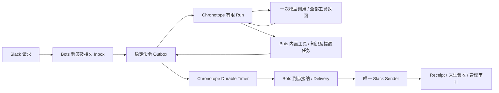

# 下一里程碑（期 8）：组织 Bot 的知识与提醒闭环

> 2026-10-19 重新评审。源码基线：`9d14760`。状态：**设计可进入实施，代码与业务验收尚未完成**。
> 最新约束：Chronotope 是未上生产的 MVP；Bots 仍是设计/空目录。允许破坏 API/schema、删除旧路径、清空开发数据及 `down -v` 重建，**不建设历史兼容或迁移工程**。
> 本文替代前序期 8 的 A–F 全量前置。职责与 RSI 长文保留为能力边界/后续参考；**本期只按 G0/G1/G2 验收，不要求先完成 I01–I23 或全部研究用例**。

## 1. Review 结论

方向成立，但上一版无法作为紧凑 MVP 排期：它把真实工具闭环、接纳与调度修复，同多 provider、完整多 Agent、通用来源平台、企业治理和自动 RSI 发布串在一起；还假设已有生产历史，需要兼容窗口和迁移。

本期的唯一主路径是：**管理员配置一个组织 Bot → 成员在 Slack 请求学习一条信息并安排提醒 → 真实模型调用内置工具 → Bots 持久保存知识和原生提醒 → Chronotope 耐久等待 → 等待中重启 → Bots 向原 Slack thread 发出一条提醒并保存真实 receipt → 管理员能查看状态/暂停。**

提醒不要求外部日历/工单，不需要第二个连接器，不需要在到点时再次推理。内化业务知识是 Bot 自有资产；外部应用仍拥有自身消息、资源权限和对象状态。

### 1.1 源码中真正阻断主路径的问题

以下是本轮直接读取源码的结论，不是新运行的测试结果：

| 问题 | 源码证据 | 本期直接处理 |
|---|---|---|
| 工具结果未稳定回喂；同轮多工具可能只返回第一个 | [harness main](/Users/yangziwen/workspace/git/BingdiLotus/chronotope/harness/app/main.py:130)、[provider](/Users/yangziwen/workspace/git/BingdiLotus/chronotope/harness/app/llm.py:74) | 删除内联工具循环，一段只做一次模型请求，返回全部 tool calls；Go worker 执行并回喂真实结果 |
| 自定义应用工具被词汇表过滤，缺少描述/schema/可信调用上下文 | [toolsFromConfig](/Users/yangziwen/workspace/git/BingdiLotus/chronotope/internal/restate/run_workflow.go:913)、[帧校验](/Users/yangziwen/workspace/git/BingdiLotus/chronotope/internal/restate/harness_client.go:133)、[工具类型](/Users/yangziwen/workspace/git/BingdiLotus/chronotope/internal/core/runs/runs.go:45) | 增加小型应用工具调用接缝，固定工具表和合法模型名称；不先造插件/MCP 平台 |
| run 已持久化，但 HTTP 和 recovery 同步等待整个工作流 | [submitRun](/Users/yangziwen/workspace/git/BingdiLotus/chronotope/internal/api/handlers.go:192)、[recovery](/Users/yangziwen/workspace/git/BingdiLotus/chronotope/internal/api/recovery.go:52)、[command/outbox](/Users/yangziwen/workspace/git/BingdiLotus/chronotope/internal/store/repos.go:167) | 直接改为默认异步 `202 + run_id`，outbox 可靠提交；补受权的运行结果查询 |
| schedule API 同步等 timer；调度器混合唤醒、策略与新模型 run | [createSchedule](/Users/yangziwen/workspace/git/BingdiLotus/chronotope/internal/api/handlers.go:385)、[scheduler](/Users/yangziwen/workspace/git/BingdiLotus/chronotope/internal/restate/scheduler.go:40) | 替换为独立通用 timer，复用 Restate Sleep；到点只投递 opaque action ref |
| 有认证但使用中的资源未逐项校验归属；凭据解析传空 org | [auth](/Users/yangziwen/workspace/git/BingdiLotus/chronotope/internal/api/auth.go:144)、[session 查询](/Users/yangziwen/workspace/git/BingdiLotus/chronotope/internal/store/repos.go:98)、[verifyCredential](/Users/yangziwen/workspace/git/BingdiLotus/chronotope/internal/restate/run_workflow.go:699) | 修本期暴露的 agent/session/run/tool 路径和 tenant/bot/scope；关闭未用管理入口，不先做完整企业 RBAC |
| tenant 共享知识自动注入 trusted system，不能提供最小 scope 隔离 | [knowledge](/Users/yangziwen/workspace/git/BingdiLotus/chronotope/internal/store/knowledge.go:32)、[buildMessages](/Users/yangziwen/workspace/git/BingdiLotus/chronotope/internal/restate/run_workflow.go:817) | 参考 Bot 禁用此自动注入，知识走 Bots scoped 表及显式 recall 工具 |
| 通用 Deliverer 对错误自动重投，不适合作为最终 Slack sender | [delivery](/Users/yangziwen/workspace/git/BingdiLotus/chronotope/internal/api/delivery.go:65) | 最终发送固定在 Bots，单独保存 claim、请求摘要、Slack ts/unknown；不借用盲重试发送路径 |

保留既有 Go run loop、PG、Restate、消息/效果记录和 LiteLLM/Python provider。工具错误也必须带原 `tool_call_id`；usage 未知与结果未知分别记录；同终态同结果重放应幂等确认。这些是所选路径的小修，不另立平台项目。

## 2. 已确定的最小范围

| 项目 | 本期选择 |
|---|---|
| 使用者 | 一个组织、一个管理员、一个 Bot；tenant/bot/scope 字段仍必填，并做第二组织的负向 fixture |
| 交互 | 一个 Slack workspace、一个私有安装的 Bot 应用账号、一个测试频道；@mention 后按 thread 接续。成员不进入 Bots 聊天页面 |
| 管理 | G0/G1 用配置文件和受权 API；G2 再补一页配置/启停/知识/任务/receipt 管理视图，不先做完整控制台 |
| 账号 | 管理员预先绑定 Slack token/signing secret；不做应用市场、成员 OAuth 或多身份委派 |
| Agent | 一个现有可用模型、一份 SOP、一个 Go loop + Python provider；有限 steps/token/时间/任务数上限 |
| 工具 | `remember`、`recall`、`create_reminder`、`update_reminder`、`cancel_reminder`；JSON Schema 固定，先走一个 typed HTTP bridge |
| 回复 | 模型不直接发 Slack。Bots 读取运行终态后创建一次最终回复；提醒到点也由同一个 Bots sender 发送 |
| 知识 | Bots 直接建 scoped PG 表，支持新知识/经验、来源、修订与停用；scope + 最近/关键词检索，无向量检索前置 |
| 原生工作 | 一张 BotTask 表表达提醒目标、简单计划、承诺内容/验收及单次调度字段；不先拆 Plan/DAG/Schedule/Commitment 引擎 |
| 调度 | 单次绝对 `due_at`，输入时区明确；支持显式改期/取消、迟到和暂停处理。周期 cron、自动跟随外部日历后置 |
| 部署 | 一个 Chronotope provider、一个 Bots 服务、同一 PG 服务的独立 schema；不引入第二套 workflow/broker |

测试频道是安装与路由范围，不是 Bots 另建的客户/成员业务白名单。Bot 只向可信源事件绑定的 reply target 发送；原生提醒不要求日历写权限，实际 Slack 发送仍服从当前账号权限。

## 3. 项目与状态归属

| 状态 | 唯一 owner / 本期存储 |
|---|---|
| Bot、人格/SOP/工具上限、知识、原生任务与原生验收 | Bots；直接落 `bots` schema，不先建设 Chronotope 通用 Record API |
| Slack 账号/事件接纳、thread→session 映射、待提交命令、发送账本 | Bots；持久 inbox/command outbox/delivery，只有 Bots 调用 Slack Web API |
| runtime agent、session、run/step、模型历史、执行结果、通用 timer | Chronotope；既有 PG/Restate；不让 Bots 或 SDK 另存一份模型 history 并双重 replay |
| Slack 源消息、频道成员、原始会话及 API 权限 | Slack；Bots 保存必要有权来源和输出 target，不接管源对象 |

Bots 项目地址：[BingdiLotus/bots](https://github.com/BingdiLotus/bots)，本地 `/Users/yangziwen/workspace/git/BingdiLotus/bots`。目录原为空，现仅有启动设计文档；本地 Git 已初始化，remote 尚未绑定，产品代码待实现。

Bots 先用 Go HTTP 服务 + PG；按 API、Slack adapter、内置工具、store、dispatcher 分包，不拆微服务。Chronotope 的 `internal` 包不跨仓库导入；只写小型 HTTP client。部署时把 Bots 服务加入现有开发 compose，不复制一套 PG/Restate。Bots 的启动结构见[本地 MVP 设计](../../bots/docs/MVP设计.md)。

### 3.1 配置版本只保留必要快照

Bots 保存稳定 BotID 和配置 revision；每个 approved revision 创建一个不可变 runtime agent 配置，Bots 保存其 `runtime_agent_id`。复用当前 agent create/config digest/run.bound，补创建幂等性即可；不先造跨 provider BotRuntimeBinding 管理框架或独立 RuntimeReleaseBinding 服务。

首次 YAML 只作初始化导入；导入后 Bots PG 是配置唯一权威，API 更新写同一状态，重启不从 YAML 覆盖管理修改。配置内容和 revision→runtime agent 的不可变映射保留在配置审计事件中；runtime 创建未确认前不切 active revision。agent/session 创建统一用稳定客户端键和请求摘要，同键同请求返回原 ID、异请求冲突；Bots outbox 修复远端创建成功、本地映射未保存的窗口。

session 映射唯一键是 `tenant/bot/installation/channel/thread`，**不含配置 revision**；首次建立映射时冻结 revision/runtime agent，后续 inbox 绑定实际映射版。只有新映射选择当前 approved revision。配置切换验收用新 thread/session，不实现热迁移历史。知识 scope 默认是 `tenant/bot/installation/channel`，独立于 thread/session，因此新 thread 可 recall 同频道知识；其它 channel/tenant 不自动共享，DM 不在首版开放。原生知识/任务不随配置回滚清空，当前启停、工具和账号上限仍复验。

## 4. 主路径与最小接口

### 4.1 模型和工具协议：直接修一条路径

- harness 每段只调用模型一次；收齐全部调用后输出所有 tool calls 和终态/usage，worker 按确定顺序执行，再把完整 assistant/tool 结果带入下一段。成功、业务错误、参数错误都关联原 call ID。
- 允许一轮同时 `remember + create_reminder`，不能遇到第一条调用就 return；明确工具描述、schema、名称 alias，不只传 risk_class。无效 JSON/参数回喂错误，不静默改成 `{}` 后执行。
- 应用工具只到配置的 Bots 内部地址，目标不由模型提供。worker 注入可信 `tenant_id/bot_id/scope_id/origin_command_id/run_id/operation_id` 和服务认证；模型参数不创建权限或业务去重身份。
- 本期关闭 generic HTTP、shell、浏览器和未选 SDK adapter 的参考 Bot 能力；不为未开放能力预建沙箱/网络代理平台。其他旧模块不进入这条验收路径。
- 继续使用 16-step 或明确配置的有界上限与无进展停止；不做永久 model loop、epoch rollover 或第二套状态管理。

上限落实在执行门：模型请求设置所选 provider 支持的输出 token 上限；每 run 保存最大模型/工具轮数与绝对 deadline，派发前检查并使用剩余时间作为请求 timeout；每 Bot 一个模型 run 并发，未完成提醒数量在 Bots 创建事务中锁 Bot 行检查。unknown/blocked 任务仍占数量额度，重试不重新扣同一创建；事后 usage 只作计量，不冒充调用前限额。无需本期建设分布式多层收费系统。

### 4.2 Slack 接纳、排队和终态读取

1. 校验签名/时间、installation→tenant/bot 绑定与事件类型；先提交 inbox，再按 Slack 期限 ACK。相同 source event 去重。
2. 同 thread 串行消费；忙时输入留在 PG 队列，不因 `session active` 丢弃或标永久失败。简单 poller 足够，不先实现完整 actor/mailbox/signals。
3. 用稳定 command ID 调 Chronotope；run/command/outbox 同事务接纳，直接 `202`。幂等查询先于 active-run 冲突判断，同 ID 异请求拒绝。
4. Bots 持久保存 run handle，轮询受权的 `GET /runs/{id}` 读取 canonical status/final/error/usage；终态与 final/error 同一提交后可见，不出现 completed 但结果尚未保存的窗口。SSE 不是正确性的唯一来源。
5. run 终态后，Bots 同事务更新 inbox disposition、审计和唯一最终回复 delivery。重启后可继续查询/落账；不能仅靠内存回调。

### 4.3 内置工具与原生任务

`remember/recall` 固定 tenant/bot/knowledge scope，保存真正内化的知识及来源/修订；内容作为数据，不升级为系统授权。参考 Bot 同时关闭旧 tenant knowledge 自动注入与 consolidation 触发，避免重复整理/隐藏模型调用。新 thread 能读取同频道有权知识，不因同 Bot 自动合并其它频道/组织内容。

所有写工具（包括 remember、create/update/cancel）把 `operation_id + request/context hash + 原返回值` 与业务修改/审计同事务保存，可复用 Bots inbox 的 tool-operation 命名空间，不加独立框架。重试先核对该 receipt，同请求返回原结果，异请求冲突；否则成功 update 的响应丢失后会被误报 revision 冲突。调用幂等与下述提醒槽去重分别保留。

`create_reminder` 只接受时间/文本等业务参数，target 从可信上下文取。Bots 本地事务写 BotTask、审计与待调度 outbox 后立即返回 task ID，不等待到点。每个原始输入 MVP 最多一个提醒槽：`(bot_id, origin_command_id, reminder_slot)` 唯一，防模型后续轮次重建；相同意图重复调用返回原任务，异内容要求显式 update。不要只用 run/step/tool_call_id 去重业务提醒。

`update/cancel` 仅在尚未 claim 时校验 scope、expected revision 并与 sender claim 争同一 task/delivery 行；sender 已 claim/dispatching 或 unknown 时拒绝改期/取消，等待核对，不另建替代 timer。已确认完成的提醒不能再改成“未发”。本地改期不修改会议；第一版固定时间，源消息编辑不自动重写已确认提醒，需显式改期。已接纳的源删除/权限失效按直接 source refs 停用相关知识和未派发提醒，保留任务状态；不先做递归派生图，也不声称发现所有未送达的源端变化。

## 5. Timer 与发送：主路径的可靠性底线

### 5.1 一个耐久计时器，不叠加第二调度器

Chronotope 增加/替换通用接口 `POST /timers`：稳定 `timer_id/revision/due_at/opaque_action_ref`，持久接纳后 `202`；同 key 同 payload 返回原 handle，异 payload 冲突。固定回调目标来自服务配置，不能由模型传任意 URL；timer 不解释 Slack 或 BotTask。

Bots pending command poller 修复“Task 已提交、timer 未提交”；提交使用同一 timer key。Chronotope 用可重放的时间/初始剩余时长和 Restate Sleep 等待，已经过期则立即投递 fire。Bots **先持久接纳 fire/创建 delivery 后 ACK**，按稳定 fire ID 去重；Bot 暂停时也接纳 fire，只阻断后续发送 claim，避免唤醒丢失。timer fired 不等于 task 完成。

timer 更新可建新 revision 对应 invocation；取消以 Bots task revision/status 为最终门，旧 timer 到达只记录 ignored，不产生新发送。主动取消底层 Sleep 是资源优化，不是正确性前提。**Bots 不再另建一条扫描到期任务并直接发送的竞争调度路径。**

等待期间重启必须保留 PG/Restate 数据；同版本恢复是本期硬验收。durable timer 到点只产生事件，既定提醒正文由 Bots 确定性发送，不调用模型，也不占用原聊天 session。

### 5.2 唯一 sender 与未知效果

Delivery 至少保存 `operation_id/task_or_command_ref/revision/target_digest/payload_digest/state/slack_message_ts/error`。固定 Bots sender 是唯一调用 Slack 的组件，不同时启用 Chronotope generic Deliverer 直接发同一条消息。

| 状态 | 处理 |
|---|---|
| pending | 可重试领取；发送前同一 Bots 事务检查 Bot 启用、任务 revision/status、账号和可信 target，并 CAS claim |
| dispatching | 可能已越过外部边界；崩溃遗留不能直接恢复成 pending 盲发 |
| confirmed | Slack `ok=true`、message ts 已持久保存；重复请求返回原 receipt |
| rejected/retryable | 明确未接受才按 Retry-After/有限策略重试；不能自动换账号 |
| unknown | 超时、连接断开或派发中崩溃且没有 receipt，保留待人工核对；不自动换 ID 重发，也不判提醒完成 |

首次提醒契约为“Slack API 确认接受且本地保存 message ts”。确认 receipt、对应 task 完成和审计同一 Bots 事务提交；迟到 receipt 始终保留，但只在 operation/请求摘要/task revision/delivery 匹配时推进 task，不能覆盖新状态。管理面展示平台已接受，不宣称已读或外部会议已举办；不对任意故障宣称 exactly-once。

暂停 Bot 后拒绝新 run 接纳和新的工具/发送 claim；已在途模型、已取得派发权的发送可能继续返回，仍记账/对账。恢复 Bot 时可重试尚未取得派发权的 due delivery，不重做 unknown。迟到策略首版为恢复可执行后发送并标注迟到；用户可在派发前取消。

## 6. 三个小阶段及主路径验收

| 阶段 | 具体交付 | 进入下一阶段的证据 |
|---|---|---|
| G0：确定性闭环 | Bots 最小配置/表、typed tools、异步 run、通用 timer、唯一 sender；先用假模型及可计数 Slack sink 验证状态机 | 事务/接纳/重启/改期/取消/unknown 测试通过，无真实外部写入 |
| G1：真实纵向路径（下一发布门） | 一个真实模型 + Slack private app；新知识、原生提醒、等待中重启、真实 message ts、管理员 API 启停/审计 | 下表必需项全部通过；真实结果与 fake 分开记录；仅凭此阶段即可发布 MVP 试用 |
| G2：最小管理与一次改进 | 一页管理视图；选一条 G1 失败/人工纠正轨迹，由 Bot 提一个 SOP 补丁及假设，固定模型对照未参与改稿的 fixture，隔离 sink、人工批准/拒绝、新 session 验证并记反馈/回退 | 一份报告绑定轨迹/补丁/revision/模型/fixture/成本；不建提案表/RSI/灰度平台，不阻塞 G1 |

| 验收 | 期望结果 |
|---|---|
| 同一 Slack event 投递十次 | 一个逻辑输入、一个 run/一个提醒槽；最终回复和提醒分别不重复 |
| 一轮两个工具 + 工具随机 nonce | remember 和 create_reminder 均执行；下一模型请求拿到真实结果及原 call IDs，不能只凭最后一句文本验收 |
| 新 session/进程重启后 recall | 读取先前知识/来源；不是从旧模型上下文碰巧复述 |
| Task 提交后、timer 接纳前杀进程 | pending command 修复，同一 timer key 接纳一次逻辑责任 |
| timer 等待中重启 Bots 和 worker | 仍到点投递；等待及到点确定性发送均无周期模型调用 |
| 工具写成功但响应丢失 | remember/update/cancel 重试返回原结果，业务变更和审计不重复，成功改期不变成误报冲突 |
| 改期/取消、旧 timer/receipt 迟到 | 未 claim 时仅新 revision 生效；已 claim/unknown 不接受替代改期；迟到 receipt 不覆盖新 task 状态 |
| 暂停 Bot、本地账号禁用、Slack 移出频道 | 已知本地禁用不取得新 claim；尚未同步的远端变化由 Slack API 拒绝并记录 rejected，不承诺两者原子同步 |
| provider 成功、receipt 已保存但响应丢失 | 返回原 receipt，不重复调用 Slack |
| provider 可能成功、receipt 未保存 | unknown 可见，重启不盲重发/不虚报 task 完成 |
| 跨 tenant/bot/scope 使用 ID | 本期开放路径拒绝，知识不串；不因单组织试用省略归属校验 |
| 执行限额 | 触及输出 token/run 次数/deadline/未完任务数上限时显式停止或拒绝；重试不重复创建/扣数 |
| 审计 | source→command→revision→run/tool→task/timer→delivery→Slack ts 可关联；默认 metadata/hash，不包含 secret |

真实 Slack smoke 使用明确配置的测试频道，不发送给任意第三方。开发短延时 30–60 秒验证计时，再补一次跨进程较长等待；无需先把 24–72 小时、多渠道或第二模型作为入门门槛。

## 7. 实施顺序与改动落点

| 批次 | Chronotope | Bots |
|---|---|---|
| 1 | 修单次推理/全工具结果回喂；应用工具 schema/alias/桥接；使用路径 tenant 校验 | 配置、schema、内置知识/提醒工具与上下文认证 |
| 2 | 默认异步 run/查询、稳定创建幂等、终态同结果可重放 | Slack inbox、session 映射、command outbox、终态轮询和最终回复 outbox |
| 3 | 通用 timer 持久接纳、Sleep、fire 重试 | 原生 Task+待调度责任、revision/cancel、唯一 Slack sender/receipt/unknown |
| 4 | 故障 fixture 和真实模型路径回归，固定依赖版本 | G0/G1 全链路、管理员启停/审计 API、部署与 reset 文档 |
| 5（G2） | 复用已有运行/版本快照，不建新发布服务 | 最小管理页、一个 SOP 候选对照和人工切换/回退 |

代码起点：`internal/api/{handlers,ingress,recovery}.go`、`internal/restate/{run_workflow,harness_client,scheduler,dispatch}.go`、`internal/core/runs`、`harness/app/{main,llm,protocol}.py`。应用工具 bridge 只做固定工具调用，MCP/A2A 与其它 adapter 不扩建。本期不改写 Restate 引擎、不引入 Redis/NATS。

## 8. 明确后置与破坏性重建

| 后置 | 恢复建设的触发条件 |
|---|---|
| 第二组织的完整运营/SSO/RBAC、多账号委派、个人 OAuth | 有实际第二部署/角色/委派需求；当前仍保留字段和隔离负测 |
| 多 Bot、peer、异步子 agent、长期 Supervisor/epoch/signals | 单 Agent 成功基线已建立，真实任务确需并行且有同预算收益 |
| 多 provider 两类 binding、完整 spec 注册/发布服务、跨版本接管 | 真正引入第二执行提供方或开始有生产在途兼容要求 |
| Plan DAG、独立承诺/日程引擎、周期 cron | 一条任务多个依赖/责任/重复 occurrence 出现；当前用 Task 字段表达原生语义 |
| 向量检索、通用 Record API、完整 lineage 修复 DAG、Dreams 批管线 | 小块知识检索不够、确有复杂来源/批量整理负载；当前保留 source/scope/revision/停用 |
| 自动提案/独立评测服务、三套大数据集、cohort/canary/自动晋升 | G2 的最小对照已有可重复收益；当前仅本地 fixture + 人工发布 |
| 沙箱/浏览器/code agent、E2B、多 executor、HA/PITR/大规模预算计费 | 主路径扩到生成代码/浏览器/生产规模时再验证；当前不暴露相关工具 |
| 旧协议双版本、旧库迁移、历史承诺分类/双读/双写切换 | **本期删除前置要求**：没有生产数据，不为假设历史建设迁移层 |

可以直接替换 schema/API/协议、删除旧内联路径，并同步契约、样例、OpenAPI 与选定回归。代码变更前后都以当前主路径测试为准，不维护旧 v1 分支或 Prefer 兼容窗口。现有源码里无关的历史模块不要求先全部搬迁；影响主路径的重构可直接完成。

开发全栈重建可用 `docker compose -f deploy/docker-compose.yml down -v` 后重建初始化；PG、Restate、对象存储数据视为同一开发代次重置，Bots schema 同步初始化。**本轮 review 未执行清库或运行中的服务重启。** 同版本“崩溃恢复”验收必须保留数据卷，不能拿 down -v 代替恢复测试；清库也不会撤销已经发到 Slack 的消息，下一轮测试使用新的场景 ID。

复用当前 Go 1.26 / Restate SDK 依赖，G0 锁定验证通过的容器 tag/digest，避免 rolling `latest` 改变重建结果；不是本期顺带升级所有组件。已有针对正确性的回归继续跑；实际修改 runtime 后跑相应测试及 `scripts/ci.sh --e2e`，跳过/缺凭据明确记为未验证。

## 9. 工业实践依据与没有照搬的部分

以下官方页面于 2026-10-19 重新读取；它们支持模式选择，不代表本项目已通过：

| 官方依据 | 采用与裁剪 |
|---|---|
| [OpenAI Agent quickstart](https://developers.openai.com/api/docs/guides/agents/quickstart) | 先一个 focused agent/一个 turn，增量加能力；不从完整多 Agent 平台起步 |
| [OpenAI Running agents](https://developers.openai.com/api/docs/guides/agents/running-agents) | 选择一套 history/state 策略，避免重复回放；本期沿用 Go loop/Chronotope 历史，不引入 SDK 双重恢复 |
| [OpenAI Functions](https://developers.openai.com/api/docs/guides/agents-api/tools/functions) | schema→应用执行→同 call 的实际 output/error→继续推理；采用调用合同，不引入托管 API 作为第二内核 |
| [Anthropic 长期 harness 实践](https://www.anthropic.com/engineering/effective-harnesses-for-long-running-agents) | 小步推进、明确交接和真实验收；不照搬多框架/大功能清单 |
| [Anthropic Memory](https://platform.claude.com/docs/en/managed-agents/memory)、[Dreams](https://platform.claude.com/docs/en/managed-agents/dreams) | 持久小块知识先可用，批量整理不是日常学习前置；Dreams/research preview 和完整自改进后置 |
| [Grok Skills/Routines](https://docs.x.ai/grok-bot/skills-routines-and-automations) | 一次任务可靠，再保存方法，再自动重复；test run 会有真实动作，故本地 eval 用隔离 sink |

详细事实、版本及限制继续参见[工业产品调研](./工业产品调研-持久Agent与托管运行平台-2026-10.md)与[前沿研究](./前沿调研-持久Agent与非模型自改进-2026-10.md)。产品所有权仍以[职责边界](./Chronotope与Bingdi-Bots职责边界.md)为准；实现范围以本期 G0/G1/G2 为准。
