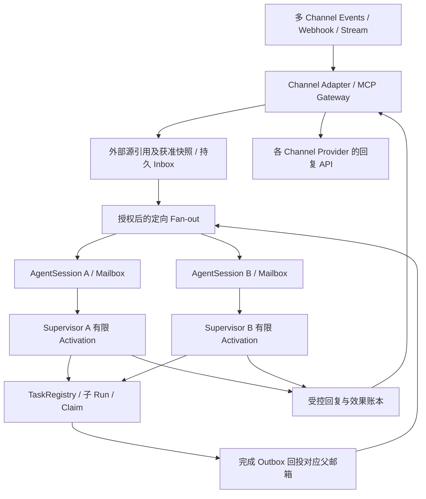

# 多 Agent 持久会话、MCP 消息订阅与父子编排：可行性及方案横评

> MVP 范围修订：本文比较多 Agent/协议的后续路线，不再作为首个闭环的前置清单。当前[期 8](./期8-细化落地方案.md)只做单 Agent、typed HTTP 工具、PG 队列与 Restate timer；完整 MCP 订阅、长 actor/signals、peer/children 在单 Agent 主路径验证后按真实需求启动。无生产数据的协议/库结构可直接改，不建设兼容/迁移框架。

> 调研日期：2026-10-18。Chronotope 源码基线：`9d14760`。
> 方法：实时阅读官方规范、产品文档与官方开源代码/说明，交叉检查本仓库实现。
> 证据等级：本文证明相关机制已有规范或实现依据；未部署横评产品，未执行新的 PoC、故障或性能测试。优缺点和迁移成本为基于已读材料的工程判断。
> 关联：[期 8 细化落地方案](./期8-细化落地方案.md)。本文细化其中的常驻 Supervisor、同会话多 agent、MCP 与持久消息边界。

> ToB 归属修订（2026-10-19）：按[职责边界](./Chronotope与Bingdi-Bots职责边界.md)，Bots 治理组织 Bot，并拥有其内化知识、经验/技能、原生任务、计划、调度与自身工作承诺；这些可存于 Bots 或 Chronotope。外部应用保有源 Conversation 和它自己的对象/规则/权限；不是所有业务相关状态都必须外置。成员交互留外部，DM 不产生个人 Bot，当前仍待实施。

## 1. 结论与适用范围

**方案在架构上可行：共享 Conversation，各 agent 使用独立持久 AgentSession/邮箱，父 agent 编排异步子任务，MCP 提供消息与工具接口。** 现有产品已分别验证这些组成部分；本仓库仍需补齐组合合同和真实故障验收。

推荐对 Chronotope 采用：**保留 Restate + PG，增加持久 inbox/fan-out、有限 activation 的 Supervisor、子任务完成回投、任务领取与受控回复；MCP 作为接入协议，A2A 作为可选的外部 agent 互操作协议。**

关键依据：

1. OpenClaw 已有 Slack 同群多 agent 的直接参考：各自 session、提及选择、有限后续轮次和独立工具/记忆；但该功能标为 experimental，轮次预算状态不跨 Gateway 重启恢复。[S02]
2. Restate 的命名 signals 可持久缓冲先到或后到的信号；Temporal Signals/Child Workflows 也支持长期有状态编排。这证明逻辑常驻可由持久事件驱动实现，无需持续调用模型。[S06–S11]
3. Cloudflare Agents 具有持久身份、Slack 路由和后台恢复 API；其 fibers 明确要求 checkpoint/recovery hook，并不自动重放原闭包。[S04–S05]
4. MCP 2026-07-28 已有 `subscriptions/listen`，但订阅随连接结束，且不支持旧版 Last-Event-ID 恢复。通知不能代替业务日志、消费确认和补读。[S16–S18]
5. A2A 1.0.0 适合异构 agent 的任务与 artifact 交互，但 contextId 不等于共享内存，消息与 webhook 也不构成应用所需的可靠事件总线。[S20]

因此，可行性应分为三项验证：**会话与协作形态可行、持久执行有机制支撑、端到端可靠性与任务质量尚待本项目 PoC。**

### 1.1 范围扩展：持久主体、多 channel 与非模型 RSI

后续需求明确：组织 Bot 身份跨应用、session 与 harness 版本延续，可内化业务知识/技能并自主创建任务和调度，不必先有外部 issue/calendar。Bot 原生工作责任与外部系统合同/工单分别持有权威，harness、memory 方法及 loop/SOP 可受控改进。结构见[持久身份与 RSI 设计](./持久Agent身份与非模型RSI设计.md)，既有协议证据不等于所有集成或 RSI 已完成。

主体 `agent_id`、参与会话 `AgentSession`、执行账号 `ExecutionIdentity` 与不可变 `AgentRelease` 分开；memory policy 的升级不同于事实纠错，承诺事实权威也不属于可由反思覆写的记忆。模型权重不在本期自改进范围。

## 2. 需求拆解与比较口径

目标场景：多个不同 agent 可参与同一逻辑 Conversation，并通过 Slack 或其他 channel 交互；每个 agent 长期存在、按事件醒来并派生子 agent；跨渠道身份与义务延续，执行可跨重启/跨天，回复遵守对应地址和来源权限。非模型 RSI 的机制参考另见 §10.1。

| 维度 | 需要回答的问题 |
|---|---|
| 共享会话 | 共同可见的消息存在哪里？谁能读？怎样与私人记忆分开？ |
| 常驻身份 | agent 如何在休眠、迁移、升级后保持同一逻辑身份？ |
| 消息消费 | 多 agent 是各收一份，还是竞争消费？去重、游标和确认谁持有？ |
| 父子编排 | 派发后父 agent 能否继续接消息？结果、超时、取消如何回流？ |
| 恢复语义 | 恢复的是快照、节点、操作结果还是程序进度？未知效果如何处理？ |
| 协作约束 | 谁负责某个任务、谁需要回复、怎样停止 agent 间的循环？ |
| 安全与成本 | 工具、凭据、数据与输出受众如何授权？并发和预算如何限制？ |
| 接入成本 | 在现有 Restate/Go/PG 上增量建设，还是迁移语言、运行时和部署？ |

本文分别比较运行时、协作拓扑、通信协议和消息后端；它们位于不同层，不能仅用一个“是否支持多 agent”或总分替代分析。

## 3. 直接可行性依据

### 3.1 OpenClaw：最接近用户交互形态的现成参考

官方 Multi-agent routing 以一个 Gateway 内的独立 workspace、agent state 和 session store 定义 agent。[S01] 普通 bindings 按优先级选中接收者，不自动将一个事件广播给全部 agent。

官方 Broadcast groups 已明确支持 `slack:C0123` 一类限定频道配置：多个参与者处理同一输入、各自使用 session，按 mention 选择初轮参与者，并通过有限 digest 接续讨论。原文边界尤其重要：[S02]

> “Each agent runs in its own session.”
>
> “It is not restart-resumable: a Gateway restart loses the active round and budget state.”

该功能标记 **experimental**。`maxRounds`/`maxTurns` 限制逻辑发言回合；一个 turn 仍可能产生多条物理消息，因此不能把 turn 上限视为 Slack 发送配额。默认路由、组激活和授权仍生效。

Sub-agents 文档支持后台独立 session、结果返回请求者、主运行继续响应；专家任务与聊天分离的模式有直接实现参考。[S03]

**可借鉴**：频道 binding、每参与者 session、定向 mention、后台专家、结果回流、独立进度/发言标签、有限轮次。

**不可据此推断**：experimental 广播已具有跨进程恢复、企业级数据隔离、任意工具 exactly-once，或所有插件存储天然按 agent 隔离。官方还明确 workspace 只是默认 cwd，不等于硬沙箱。[S01]

### 3.2 Restate 与 Temporal：长期编排的依据

Restate 官方 Go 文档提供命名 signals 的重复接收，信号可早于或晚于等待到达并被持久保存；适合消息、steering、子任务完成和外部通知。共享 handler 与独占对象写 handler 的区别仍需遵守。[S06–S08]

当前仓库依赖的 sdk-go v1.1.0 已有 `Signal/ResolveSignal/RejectSignal`。[S26] 这降低了增量实现成本，但文档没有据此给出跨发送者全局 FIFO、业务去重、背压和关闭 invocation 后迟到信号的完整合同，相关行为仍须 PoC。当前 compose 使用滚动 server 镜像，实施前必须锁定兼容版本。

Temporal 将 Workflow 描述为可通过 Signals/Updates 交互的有状态服务；Signals 可在 worker 未运行时由服务端接纳，Signal-With-Start 能将启动与信号投递组合。Continue-As-New 用新的 Run/history 延续同一 Workflow ID，适合长期逻辑会话。[S09–S11]

异步 child 还需明确 ParentClosePolicy，并等待 ChildWorkflowExecutionStarted 后再让父结束；官方 ABANDON 示例不能简化为“spawn 调用返回后立即退出就一定已启动”。阻塞的 message handler 可在 await 点交错执行，需要相应的互斥与退出前 drain。[S09–S11]

这两类机制支持“永久逻辑身份，有限执行回合”，但不直接提供 Slack ACL、共享 Conversation、业务去重或远端效果对账。

### 3.3 Cloudflare Agents：持久对象与手动恢复的另一种实现

官方 Slack 文档给出了 Worker 验签、安装识别、路由到 agent instance、多 workspace 独立存储的接入方式。[S04]

fibers 文档提供 `runFiber/startFiber/stash/onFiberRecovered`，可耐久接纳后台工作，保存中间快照，并在 Durable Object 再激活后恢复；子 agent 也可维护自己的恢复记录。[S05]

但原文明确：

> “The original closure cannot be replayed automatically.”

恢复策略由应用 hook 决定；keepAlive 只降低驱逐概率，不替代恢复。取消是协作式，不能由状态变为 aborted 推断远端效果已经停止。

## 4. 运行时与实现框架横评

“接入成本”以当前 Chronotope 为起点，表示相对工程量，不是实测工期；“需补”也不等于产品不存在其他可用集成。

| 方案 | 对本场景的优势 | 主要限制/代价 | 对 Chronotope 的建议 |
|---|---|---|---|
| **Restate + PG 增量** | 已采用的 Go SDK、journal、对象状态、等待和效果账本可复用；命名 signals 适合唤醒 | Conversation/mailbox/任务回流需自建；长独占 handler 会挡写操作；server/SDK 特性组合仍需验证 | **首选**。迁移成本低，机制补齐成本中等；以本地 PoC 验证 signals 与恢复 |
| **Temporal Workflows** | Signals/Updates、Continue-As-New、Child Workflows 对长期编排表达完整；有清晰的异步消息与 child 生命周期语义 | 要迁移执行引擎、history/worker 运维与升级规则；仍需工具幂等和权限面；不能直接消费 Restate journal | 作为设计对照；已有 Temporal 团队可考虑，当前项目不宜叠加第二个持久引擎 |
| **Cloudflare Agents SDK** | 持久对象、Slack、多 workspace、实时连接与后台任务 API 集成度高；适合托管快速交付 | 生产执行依赖 Cloudflare 平台；fiber 恢复 hook 与自动 journal 重放不同；需明确跨对象协作与副作用合同 | 托管优先时是强替代；完整自托管目标下借鉴 actor/routing，不作为透明执行器替换 |
| **OpenClaw** | 多渠道 routing、同群多 agent、独立 session、后台专家与用户体验最直接 | 同群广播 experimental；轮次/预算不跨重启恢复；隔离与插件状态需分别配置，不能仅凭 persona 区分信任域 | 作为产品/交互原型与对照，借鉴消息路由和任务回流；不直接代替本项目持久合同 |
| **LangGraph** | graph、子图、checkpointer、interrupt 适合定义 agent 决策与任务流；可选择临时或跨调用子图记忆 | thread/namespace 不等于共享 Conversation；恢复可能重跑节点；副作用和同 namespace 并发需特别设计 | 可作为可选决策/harness 层。明确其 checkpoint 与 Restate 的恢复所有权，避免同一效果双重重试 |
| **Microsoft Agent Framework** | 提供新一代多 agent workflow、checkpoint 与持久运行扩展路径；适合 Microsoft 技术栈 | 基础 checkpoint 和完整 durable 部署不是同一能力；引入新语言/宿主与现有引擎的衔接需评估 | 作为编排模式及 Microsoft 部署备选，不能直接把 SDK checkpoint 当后台永久运行保证 |
| **AutoGen** | 历史 GroupChat/Selector/Swarm 与 Core actor/pub-sub 对协作模式很有参考价值 | 官方仓库当前明确 archived、停止维护；AgentChat 的轮转讨论也不同于持久多 actor | 保留设计参考，新建设计不把它作为长期受支持基础依赖；新 Microsoft 路线看 Agent Framework |

LangGraph、AutoGen 与 Agent Framework 的细化依据及维护状态见 [S12–S15]。这些方案均未在本次横评中部署，无法据此给出吞吐、恢复耗时、任务成功率或价格排序。

### 4.1 LangGraph：临时子任务与长期子 agent 分别配置

- 子图 `checkpointer=None` 每次调用隔离，并继承父图的 checkpoint 能力；`True` 保留同 thread 跨调用状态；`False` 关闭该路径的 checkpoint。[S13]
- 官方明确 per-thread 子图不支持 parallel tool calls，同 namespace 并发会冲突。应先划分 agent instance/namespace，再谈同会话并行。
- interrupt 恢复从节点开头重新执行；API 副作用需要放在可 checkpoint 的 task 中，并设计幂等。sync/async/exit durability 也有不同崩溃窗口。[S13]

因此，持久子图可以借鉴为长期 AgentSession，但不能直接把一份 thread checkpoint 当成所有平级 agent 的并发共享状态。

### 4.2 Microsoft：团队策略、actor 与持久宿主是三层

AutoGen AgentChat 的 Selector/Swarm 是轮流广播或 handoff；Core 的 `(Agent Type, Agent Key)`、direct message 与 topic pub/sub 更接近独立可寻址 agent。Core 分布式 runtime 的官方文档标为 experimental。[S25] `save_state/load_state` 证明可序列化，不等于后台任务和 mailbox 已自动耐久。

Agent Framework 用明确边连接独立输入/输出的子 workflow。基础 checkpoint 包含内存、本地文件和面向分布式的存储选项，部署保证随选择而变。[S15]

截至调研日，Durable Extension 支持 Azure Functions 与 BYOC/self-hosted 形态，依赖 Durable Task 后端；文档当前列 C#/Python，Go 为 coming soon。它是可比较的完整持久部署路线，而不是只能云端托管，也不是零成本附加到现有 Go/Restate 中。[S15]

## 5. 协作拓扑横评

| 拓扑 | 优点 | 风险 | 推荐场景 |
|---|---|---|---|
| 单父 Supervisor + 异步子 agent | 对外口径集中、任务归属清楚、预算与上下文容易控制 | 父决策形成瓶颈；串行等待 child 会降低响应性；父故障需可靠完成回流 | **首版编排结构**；按任务需要派发 child，以强单 agent 为效果/总成本对照 |
| 多个平级 Supervisor + 私有邮箱 | 每个 agent 能长期自主处理角色任务，适合一个频道多角色并存 | 竞争领取、重复写、相互触发和受众隔离更复杂 | **有限开放**：先定向 @、任务 assignment，再允许有限 peer 协作 |
| 主持人/Selector 驱动群聊 | 发言轮次可控，适合讨论、评审和辩论；状态集中容易观察 | 所有交流通过主持者；共享 transcript 膨胀；不天然是多个常驻参与者 | 阶段性讨论任务；复用本仓库现有 group 路径并明确限制 |
| 全员广播、每条消息都推理 | 原型直观、参与者能立即看见共同输入 | token 与模型并发迅速增长、消息风暴、重复任务、上下文污染 | 仅限有硬回合/预算上限的短实验，不作为常驻默认 |
| 每 agent 一个普通无限 MCP long-poll loop | 接口少、容易在单机演示；长轮询本身可以有效等待 | 进程/连接状态未持久化时易丢游标；重启、外部未知效果和版本升级需另做 | 可作为 transport 实现；不能仅凭该循环宣称 durable agent |

主持与平级模式可以共享内核，区别放在 ConversationPolicy。一个平级 agent 内部仍可以是父子树，组内交流不要求把所有 agent 强制挂成一个总父节点的工具。

### 5.1 最新实验约束：可运行不等于值得协作

2026-10-19 的[前沿调研](./前沿调研-持久Agent与非模型自改进-2026-10.md)补充了正式发表的 [Capable language models can outgrow the benefits of collaboration](https://www.nature.com/articles/s42256-026-01268-y)：在控制工具、prompt 和系统预算的 260 个配置中，强单 agent 基线是最稳健的协作收益预测量。作者将其限定为 practical selection rule，不是多 agent 普适缩放规律；部分协调税关联经校正后不显著，不应推导为所有任务的固定性能损失。

因此，Bots 应为强单 agent、Supervisor+children 与候选 peer 做同任务、同模型、**全团队总预算**的准入对照，收益不明确时保留现行/单 agent。Chronotope 提供全部父子调用、任务/attempt/operation、通信和预算证据，不决定协作价值；同会话多个 Bot 可长期存在，不要求每条消息都激活全部参与者。

MAST 与 Agents of Chaos 进一步支持交接、错误 child 结果、资源循环和假完成的反例测试；它们不证明本项目的 mailbox、claim 或恢复合同已正确。具体研究版本、局限与期 8 增量见前沿调研 F12–F15。

## 6. MCP 与 A2A：版本、能力和边界

### 6.1 MCP 不能跨版本拼接保证

截至调研日，官网 latest 指向 **2026-07-28**。[S16] 仓库既有 2025-11-25 调研是历史材料，不能直接沿用其 session、GET 和 SSE 重放结论。

| 能力 | MCP 2025-11-25 | MCP 2026-07-28 |
|---|---|---|
| 协议会话 | initialize；可选 Mcp-Session-Id | 去除协议级 session 与初始化握手，请求携带版本/能力 |
| 订阅 | resources/subscribe；GET 等接收通知路径 | subscriptions/listen 的 POST 响应流 |
| 断线重放 | 服务端可选支持 SSE ID 与 Last-Event-ID | 不支持 Last-Event-ID/SSE 消息重投；中断后以新 request ID 发起请求 |
| Tasks | 核心中的 experimental 能力 | 独立 opt-in 扩展，2026-07-28 schema 标 Stable |

新版 subscriptions 的 acknowledged 表示过滤条件被接纳，不是“某条业务消息已被 agent 处理”。连接断开结束订阅；资源更新通知表明资源变化，不自动包含完整聊天日志、作者、任务归属或消费位置。[S17–S18]

MCP Tasks 扩展支持长操作 handle、状态/结果查询、需要输入和取消；双方必须明确声明支持。其 TTL 允许服务端在期限后丢弃任务，取消为 cooperative/eventually consistent；标准稳定不代表仓库客户端或所有 SDK 已支持。[S19]

推荐提供自定义业务工具/资源，例如：

```text
conversation.watch(scope, filters) → persistent watch_id
conversation.read(watch_id, after_cursor, limit) → events + next_cursor
conversation.reply(task_ref, reply_target_ref, business_operation_id, content)
task.get(child_ref) / task.cancel(child_ref)
```

以上仅示意接入工具命名，不是 MCP 标准聊天室对象。`conversation.*` 由 AppBinding 指定的 adapter/bridge 操作外部会话引用；`watch_id` 管耐久接入消费，MCP `subscriptionId` 是连接级关联。此处 `task.get/cancel(child_ref)` 专指 runtime child；Bots 还可提供原生 BotTask/Plan/Schedule 工具并拥有其台账和验收，不要求先建外部任务。runtime child、BotTask、外部 issue 三种取消分别执行，不能互相冒充。

调用身份、scope、业务 operation ID 与 reply target 由可信运行时绑定并在网关校验；模型可以提出操作意图，但不能通过自报工具参数获得额外权限或制造新的去重身份。

重连顺序：重新建立协议订阅 → 按耐久 cursor 补读 → 幂等接纳为 agent activation → 更新消费进度。新的 JSON-RPC request ID 不应自动产生新的业务 operation ID，尤其对发送消息等外部动作。

### 6.2 A2A 适合外部任务互操作

官网最新发布版为 **1.0.0**。[S20] Agent Card、任务状态、输入补充、artifact、任务订阅与 push notification 适合对接不同团队、框架或组织提供的 agent。

但需保留以下边界：

- contextId 逻辑分组 Tasks/Messages；保存内部 history/LLM state 是 MAY，也允许过期，不是所有参与者自动共享的记忆。
- 规范明确 Messages 不应用作关键信息的可靠交付机制；重连可能丢失状态消息。
- push 至少尝试发送一次，重试为 MAY，并可能停止；客户端仍需验来源、幂等接纳、状态查询与修复。
- Send Message 幂等是 MAY；任务引用不自动提供父子 DAG、取消级联、预算继承或任务唯一领取。

**本期选择**：内部 task/run 由 Chronotope 持有；需要长 MCP 工具时将 Tasks 映射到内部 task；真实出现外部异构 agent 再增加 A2A adapter。MCP、A2A 与 Restate/Temporal 位于不同层，不互相替代。

## 7. 持久消息后端横评

| 后端 | 优势 | 需注意的合同 | 本项目选择 |
|---|---|---|---|
| **现有 PG + inbox/delivery/outbox** | 可与 command、任务引用和消费状态同 owner 事务提交；少引入组件，容易审计 | fan-out、claim/lease、补读、积压/保留策略需实现；不能把 bigserial 最大值当提交前缀；NOTIFY 仅作提示 | **首版采用**，先测真实积压与查询成本 |
| **NATS JetStream** | 持久 stream、ack/redelivery、pull consumer 和 worker pool；适合高事件流与多服务 | 同一个 consumer 的 worker pool 分担消息，不等于每 agent 都收一份；PG/stream 双写需要 outbox，外部效果仍需幂等 | 事件量或服务解耦需要时引入，不提前双建消息真相 [S22] |
| **Redis Streams** | stream ID、XREAD fan-out、consumer group、pending/claim/ack；生态常见 | 同一 group 是工作分摊；多个 agent 都要收到时需不同 group 或各自 XREAD 游标；持久性受部署/复制/保留设置影响 | 已有 Redis 运营能力时可选，仍需处理 PG 与 stream 的一致性 [S23] |

这里最容易误用的是：**多个业务 agent 各收一份是 fan-out；同一个 agent 的多个 worker 竞争处理是 load balancing。** 两者可以同时存在，但必须用不同的订阅/领取层次表达。

协议 stream 恢复、broker ack、PG 消费提交、模型请求恢复与 Slack 出站回执分别验证，不能用其中一个代替全部。

## 8. 推荐的 Chronotope 组合架构



### 8.1 逻辑实体与身份

| 实体 | 定位 |
|---|---|
| BotIdentity / RuntimeBinding / Release | 组织所有的 BotID 与治理配置在 Bots；runtime agent/spec/effective binding 在 Chronotope，映射保持迁移连续性 |
| Conversation | 源交流空间/成员协作/业务可见性归外部应用；Bots 只配 session 策略和外部引用索引，infra 使用有权引用/快照 |
| AgentSession | `(context_ref, agent_id, scope_id)` 的持久实例；context_ref 可为 ExternalConversationRef 或原生 BotWorkScope（task/plan/loop），按 SessionPolicy 分配状态/邮箱，无须先有外部会话 |
| Activation / Run | 一次有界决策或执行；记录输入事件集合、模型请求、操作及结果 |
| Subscription / Delivery | 业务 watch、收件人投递、领取与处理状态；连接通知仅用于唤醒 |
| BotKnowledge / BotTask / Plan / Schedule / BotCommitment | Bots 拥有内化知识及原生工作台账/验收，可存于 Bots 或 Chronotope；外部工作引用可选，不要求同一对象先存在于外部应用 |
| RuntimeTaskRegistry | Chronotope 管 run/child/attempt/claim 和结果；原生 BotTask 可能跨多个 run，外部 issue 也可能关联多个 BotTask，ID/终态不混同 |
| ReplyTarget | adapter/installation、外部会话地址、受众与逻辑 delivery 身份；由可信入口绑定 |

共享日志不等于共享全部私态。同一 Conversation 的不同参与者也可能具有不同读取范围；fan-out、上下文选择和输出发布各有授权点。

### 8.2 一次消息如何变成可恢复的决策

以下以 Slack 参考 adapter 说明具体 transport，其他渠道按自己的能力、认证与 ACK 合同归一化，不直接套用 Slack 字段或期限。

Bot 也可从内化知识、自主计划或现有任务创建原生待办/闹钟，由受信内置工具记录稳定 BotTask/Schedule，再通过同一耐久 command 路径派发。它不依赖新的外部消息或日历事件；普通已授权创建不走软件 release 晋升。比如会前提醒可只保存自己的时间与目标，不修改会议软件中的会议对象。

1. Gateway 按 transport 处理认证与确认：HTTP Events 校验签名/时间戳并返回 2xx；Socket Mode 通过预认证连接接收并确认 envelope_id。两者都先耐久接纳再确认，业务去重使用事件/动作身份，不能把连接 envelope 当永久业务身份。[S21、S27]
2. 结合外部应用提供的当前业务权限/触发决议与 Bots 的部署/session/能力约束创建定向投递；不在 Bots 另存成员业务白黑名单。对每个 AgentSession 独立记录 disposition，不用全局 consumed 标记。
3. 在 PG owner 事务内将投递接纳结果与稳定 activation command/outbox 关联。ack 表示输入已转为可恢复责任，不等待长工具完成，也不在事务提交前推进 cursor。
4. outbox 用稳定 workflow key 派发；命名 signal 或通知只做可恢复的唤醒提示，首次读取与重新激活均以持久 inbox 为准。
5. Supervisor 执行有限回合，模型结果经 journal/效果账本冻结；任务派发、回复等成为稳定操作身份的待执行意图。
6. 子任务独立运行；PG child task/run 终态、持久结果引用与 completion outbox 同一 PG owner 事务提交，再回投父邮箱。Restate invocation 完成通过幂等协调确认，不属于该 PG 事务；父 agent 此时仍能处理新输入、审批和取消。
7. 外部动作在受信边界授权、领取派发权、执行并记录 receipt；发送未知时停在可见 unknown，按服务能力查询或人工对账。

PG 事务与 Restate journal 之间不宣称分布式原子提交；使用持久 command/outbox、稳定身份和幂等恢复弥合窗口。对 cursor、claim、reply 与 task 各自说明谁拥有提交权。

Slack 普通频道回复经 Web API，不以入站 HTTP ACK 或订阅流作为回复通道。Slack 参考实现先选 HTTP Events；Socket Mode 可用于内网入口，但有连接运维及当前 Marketplace 分发限制，启用时另验 transport 合同。[S27]

### 8.3 常驻循环的实现边界

- 优先采用短 actor turn/有限 activation，空闲时耐久等待或被动激活；模型不承担保持网络连接的职责。
- 命名 signals 是有价值的现有 SDK 候选；实施前锁定 server 版本并做先到信号、重启、多次接收和升级 PoC。不能仅凭 SDK 有方法就认定部署组合已通过。
- 不在 `session_object` 的独占 handler 中等待消息、审批或 child；短 handler 维护协调态，长等待放独立 workflow 或异步完成通路。
- 每个 epoch/activation 限制事件数、模型轮次、wall time 与成本；轮换时记录新 owner/generation、未完成任务和游标，拒绝旧执行者的迟到变更。
- 父 activation generation 与子任务 attempt generation 分别记录。父轮换不废弃仍有效的 child；完成事件按稳定 `parent_agent_session_id + task_id + task_attempt/result_version` 入箱，由当前父 owner 消费。失效 task attempt 的结果保留事实/审计，不覆盖当前任务状态。
- fencing 的边界是新派发 claim：新 generation 生效后拒绝旧 owner 的新 claim；此前已接纳的在途效果继续收据落账/对账，不因换代重发，也不宣称可以撤回。
- 如果确需长期单 workflow，必须说明 journal/history 上限、升级 drain、信号转交与待处理消息搬迁；不能只删除 maxSteps。

### 8.4 多 agent 的协作与输出约束

- 明确 `sender/recipients/task_id/causation_id/correlation_id/requires_response`；同一底层事件对同一 AgentSession 幂等接纳。
- 默认观察不触发推理，定向消息/任务/结果才唤醒；过滤自己的 transport 回声，但不能一律丢弃其他机器人消息。
- 回合数、预算与重复提醒状态必须持久化；重启不能重置上限。逻辑 turn 限额和 Slack 物理消息限额分别控制。
- 一个任务需要唯一 owner 时用 task claim/lease/fencing。现有按 AgentID 领取及只检查 claimed 的完成操作需扩展 expected owner/attempt/generation，不能认为已区分同一 agent 的两个 worker。并行独立评审则是不同 WorkItem，不抢一个全线程锁。
- 不同 run_id/tool_call_id 不能证明业务动作不同；外部 operation identity 与任务和目标绑定，防多个 agent 重复执行同一写操作。
- agent 间协作优先走内部事件与任务引用，Slack 仅发布需要让人看见的内容；避免把内部消息回路全部绕经公共频道。
- 取得 task claim 不等于获得工具授权；委派继承或缩小 scope，私人连接器和输出受众分别重验。

## 9. 本仓库现状与增量缺口

| 已核查的代码 | 当前边界 | 需要的增量 |
|---|---|---|
| [session_object.go](../internal/restate/session_object.go) | 单写者对象，session 级审批/取消/沙箱状态 | AgentSession 与 Conversation 分离；审批/取消按 task/operation 定位 |
| [run_workflow.go](../internal/restate/run_workflow.go) | 单次 run、固定 maxSteps；Go 控制 durable loop | activation/epoch 身份、邮箱输入与有限决策 |
| [steering.go](../internal/store/steering.go) | 文本队列，无通用收件人/来源/child result | DurableMailbox 的事件类型、状态、游标与幂等身份 |
| [group.go](../internal/restate/group.go) | moderator 的 next_speaker，child session/run，最多 6 轮 | 现有模式继续支持；新增平级持久参与者，不把 participants 当完整实现 |
| [subagent.go](../internal/restate/subagent.go) | foreground 等待结果；background 建行后返回，未主动派发并缺父邮箱回流 | 可靠 detached 接纳、完成 outbox、父子任务图、取消/超时与汇合 |
| [mcp_client.go](../internal/restate/mcp_client.go) | 最小 HTTP tools/list、tools/call，没有完整订阅/协议代际实现 | 版本能力协商、订阅重连、业务 watch/read/reply；可选 Tasks adapter |
| [knowledge.go](../internal/store/knowledge.go) | tenant 级检索，缺参与者/频道 scope | 当前读权限过滤、来源/派生失效、输出受众约束 |
| [repos.go](../internal/store/repos.go)、[outbox.go](../internal/store/outbox.go) | command/admission、终态/交付有事务基础 | 复用 owner 事务并补 mailbox→activation、child→parent 等交付责任 |

本仓库使用 `sdk-go v1.1.0`，该 SDK 的命名 signals 接口可用于候选实现；运行中的 Restate server 特性支持与版本组合仍未在此次调研中验证。源码与旧进度文档冲突时，按上述代码路径和新增 PoC 校正状态。

## 10. 采用、借鉴与后置决策

| 决策 | 内容 | 原因 |
|---|---|---|
| 采用 | Restate/PG 增量 + inbox/outbox + 有限 Supervisor activation | 最多复用当前执行与审计资产，减少第二套状态权威 |
| 采用 | Conversation 与每参与者 AgentSession 分开；定向 fan-out | 直接匹配同群多 agent，并兼顾私态、并行和独立消费 |
| 采用 | MCP 接入面 + 显式业务 watch/cursor/operation ID | 统一工具入口，同时补足协议不承诺的耐久语义 |
| 借鉴 | OpenClaw 的 mention/binding、子任务结果回流和有界讨论 | 用户体验与目标最接近；将其内存轮次状态提升为持久状态 |
| 借鉴 | Temporal 的 Signals、异步 child、history rollover 与 handler 并发纪律 | 用成熟语义检查自己的设计，不引入第二 workflow 引擎 |
| 借鉴 | Cloudflare actor identity、Slack 路由、startFiber 耐久接纳 | 用于产品与生命周期设计；不混淆其手动恢复和 Restate 重放 |
| 可选 | LangGraph/Agent Framework 作为隔离的决策或外部 agent 层 | 必须明确恢复/副作用 owner；不让两个框架自动重试同一操作 |
| 后置 | A2A、独立 JetStream/Redis 消息层、全框架替换 | 出现异构互操作或可测瓶颈后再支付额外复杂度 |
| 不作为新基础 | AutoGen | 官方归档与停止维护状态不适合新增长期依赖 |

### 10.1 持久身份与非模型 RSI 的适用性

| 参考路径 | 已读取材料能支持什么 | 仍需本项目建立的合同 |
|---|---|---|
| Restate/Chronotope 增量 | 技术会话恢复、版本绑定、隔离执行与审计 | Bots 管组织 BotID、业务知识/技能资产、原生任务/调度/承诺及其验收；外部对象保持原权威，infra 可承载通用存储和执行 |
| OpenClaw | 多渠道 binding、独立 persona/workspace/session、记忆与后台专家 | 本次来源未证明完整的受控 RSI 发布闭环；不能将改写文件等同可验证改进 |
| LangGraph / Agent Framework | 状态、子流程、checkpoint 与可组合决策机制 | 核心身份、跨渠道授权、候选隔离、固定评测和发布权仍须定义；状态持久不自动保证改进有效 |
| Reflexion 作者实现 | 使用反馈/反思和持续记忆影响后续尝试 [S28] | 反思可能错误，仍需来源验证、隐私隔离、独立任务证据与正式发布合同 |
| GEPA | 对 prompts/code/config 等文本参数进行反思、变异与评测选择 [S29] | 不替代生产身份、工具授权、义务账本或发布流程，也不保证每轮单调提升 |
| MCP / A2A | 可将工具、外部任务与反馈作为接口接入 | 不是 agent 主体生命周期或 RSI 控制面的标准；协议版本/状态与业务权威分开 |

Reflexion 与 GEPA 是非模型机制参考，非部署实验。[前沿调研](./前沿调研-持久Agent与非模型自改进-2026-10.md)加入技能两道检查、来源屏障与三类评测。可将内化业务经验形成 skill，并改进检索/上下文和 loop/SOP；Bots 评测原生任务质量及治理合规，涉及外部对象时采用该方验证。候选不能改既定成功口径或承诺历史，普通记忆积累/建任务则按已授权日常能力执行。联合验收见[身份与 RSI 设计](./持久Agent身份与非模型RSI设计.md)。

## 11. PoC 与反例验收：计划，未执行

先用一个 Conversation、三个不同 AgentSession、每个可派发两个独立 child、一个计数型工具和一个可查询 receipt 的假 Slack sink 建立可控场景，再接真实 Slack 和模型。以下数字是测试输入，不是性能或可靠性实测结果。

| 编号 | 场景 | 必须验证的结果 |
|---|---|---|
| P01 | 一个事件定向 A/B，重复投递十次 | A/B 各接纳一个逻辑 activation，C 不被触发；三个消费进度独立 |
| P02 | inbox 已提交但 signal 未发，或 signal 早于 wait | 重启/修复能补投；无永久丢唤醒；不依赖活连接 |
| P03 | 同一 agent 多 worker、两个不同 agent 各处理同一事件 | 同 agent 竞争领取，不同 agent 独立 fan-out；generation 拒绝旧 owner |
| P04 | child 已接纳但父未存接纳回执；child 先完成父后恢复 | 内部 child 用稳定任务身份不重复创建；外部 child 须有幂等创建/可查询关联标识，否则进入 unknown、不盲目重建；结果回正确父邮箱 |
| P05 | A/B 同时领取需要唯一 owner 的 WorkItem | 仅一个有效 owner；租约过期接管后旧结果不能覆盖新事实 |
| P06 | 对外效果成功但本地 receipt 未保存 | receipt 可查询则对账，无查询则进入 unknown；不强求 completed、不盲目重发 |
| P07 | A/B 相互定向消息，中途重启 | 持久回合/预算上限仍有效；自己的回复回声不自激；无进展能收敛 |
| P08 | 同会话私有数据、撤权、私人连接器解绑 | 新模型输入与输出受众均受约束，其他 agent 不继承凭据或授权 |
| P09 | MCP stream 断开、用新 request ID 重连重试 | 业务 cursor 可补读；同一业务发送 operation ID 不因 RPC ID 改变而重复 |
| P10 | Supervisor 轮换 epoch、部署升级、child 迟到 | 保留游标/未完成任务与旧 journal 对应实现；有效 child 由新父 owner 接收；失效 task attempt 结果不覆盖当前状态，已派发效果继续对账 |
| P11 | 慢 child、审批挂起，同时新用户输入/取消 | 父 agent 可响应；某任务等待不占满会话写锁、不覆盖其他审批 |
| P12a | Slack 延迟、编辑/删除及限流 | revision/失效和待执行输入处理正确，429 退避，重启后恢复处理 |
| P12b | 源端 best-effort 或源事件缺失 | 可检测缺口、补读范围及未覆盖区间有记录；不承诺发现或恢复所有从未送达且无历史访问权的事件 |

PoC 报告记录：锁定的 server/SDK/MCP 版本、事件与任务身份、外部调用计数、receipt、日志/账本、水位、恢复路径、未通过与跳过项。然后才测真实负载下的延迟、调用成本、有效任务成功率与打扰率。

通过 P01–P11 及 P12a 是多 agent 试点的前置；P12b 的源端 best-effort 限制必须披露。测试“已接纳后不丢”不能扩大为“Slack 从未送到应用的事件也一定不丢”。

## 12. 研究边界与版本记录

- 官方规范描述能力合同，官方示例证明可表达某种结构；两者都不等于本仓库已经集成或生产验收通过。
- OpenClaw experimental、AutoGen archived、MCP core/Tasks 扩展版本和 A2A 发布版本均按本次访问状态记录；后续实施再次锁定依赖。
- MCP 2026-07-28 与 2025-11-25 差异较大，禁止混用初始化、订阅、重放与 Tasks 的字段/方法；本地 `/runs` v1 是另一个独立契约。
- 框架保存 transcript/checkpoint 不等于持久消息投递；actor 私态隔离也不等于已建立租户/凭据的安全边界。
- 本文未安装、部署或压测上述框架，没有横向性能数字、商业价格结论或端到端 exactly-once 承诺。

## 13. 官方来源索引

以下来源均于 **2026-10-18** 实际查阅；版本化规范用固定版本链接，滚动文档以访问日快照为依据。

| 编号 | 官方来源 | 本文使用的依据 |
|---|---|---|
| S01 | [OpenClaw — Multi-agent routing](https://docs.openclaw.ai/concepts/multi-agent) | 独立 agent/workspace/session、binding 路由、插件与沙箱边界 |
| S02 | [OpenClaw — Broadcast groups](https://docs.openclaw.ai/channels/broadcast-groups) | Slack 同群多 agent、experimental、独立 session、轮次与内存恢复限制 |
| S03 | [OpenClaw — Sub-agents](https://docs.openclaw.ai/tools/subagents)、[Parallel specialist lanes](https://docs.openclaw.ai/concepts/parallel-specialist-lanes) | 后台专家、独立 session、完成回流、队列与任务 owner |
| S04 | [Cloudflare Agents — Slack](https://developers.cloudflare.com/agents/communication-channels/slack/) | Events 接入、安装识别、多 workspace/agent instance 路由 |
| S05 | [Cloudflare — Durable execution with fibers](https://developers.cloudflare.com/agents/runtime/execution/durable-execution/) | startFiber、stash、恢复 hook、取消和闭包不可自动重放 |
| S06 | [Restate — Signals and external events，官方 MDX](https://raw.githubusercontent.com/restatedev/docs-restate/main/docs/develop/go/external-events.mdx) | 重复命名 signals、信号早到/晚到与耐久缓冲 |
| S07 | [Restate — Services，官方 MDX](https://raw.githubusercontent.com/restatedev/docs-restate/main/docs/develop/go/services.mdx) | Virtual Object 单写者、共享 handler 与 workflow |
| S08 | [Restate — Versioning，官方 MDX](https://raw.githubusercontent.com/restatedev/docs-restate/main/docs/services/versioning.mdx) | 长 handler、部署版本保留与分段执行 |
| S09 | [Temporal — Go Workflow message passing](https://docs.temporal.io/develop/go/message-passing) | Signals、Updates、Signal-With-Start 与 handler 并发 |
| S10 | [Temporal — Continue-As-New](https://docs.temporal.io/develop/go/continue-as-new) | Workflow ID 延续、Run/history 轮换 |
| S11 | [Temporal — Child Workflows](https://docs.temporal.io/develop/go/child-workflows) | 异步 child 启动确认与 Parent Close Policy |
| S12 | [LangGraph — Persistence](https://docs.langchain.com/oss/python/langgraph/persistence) | thread checkpointer、跨 thread Store、恢复边界 |
| S13 | [LangGraph — Interrupts](https://docs.langchain.com/oss/python/langgraph/interrupts)、[Subgraphs](https://docs.langchain.com/oss/python/langgraph/use-subgraphs)、[Checkpointers](https://docs.langchain.com/oss/python/langgraph/checkpointers)、[Functional API 幂等](https://docs.langchain.com/oss/python/langgraph/functional-api#idempotency) | 节点恢复重跑、持久子图/namespace、durability 与副作用 |
| S14 | [Microsoft AutoGen 官方仓库](https://github.com/microsoft/autogen) | 顶部归档/停止维护声明、迁移到 Agent Framework 建议 |
| S15 | [Agent Framework — Durable Extension](https://learn.microsoft.com/en-us/agent-framework/hosting/durable-extension)、[Checkpoints](https://learn.microsoft.com/en-us/agent-framework/workflows/checkpoints)、[AutoGen migration](https://learn.microsoft.com/en-us/agent-framework/migration-guide/from-autogen/) | 持久宿主、存储选项、BYOC、语言支持与子 workflow 边界 |
| S16 | [MCP 2026-07-28 — Major changes](https://modelcontextprotocol.io/specification/2026-07-28/changelog#major-changes) | 去协议 session、订阅 API 与移除 SSE 重放 |
| S17 | [MCP 2026-07-28 — Subscriptions](https://modelcontextprotocol.io/specification/2026-07-28/basic/patterns/subscriptions) | listen、acknowledged、资源变化通知和连接生命周期 |
| S18 | [MCP 2026-07-28 — Streamable HTTP](https://modelcontextprotocol.io/specification/2026-07-28/basic/transports/streamable-http#receiving-messages) | Last-Event-ID 不支持、请求流中断后的重新请求 |
| S19 | [MCP Tasks 扩展官方仓库](https://github.com/modelcontextprotocol/ext-tasks)、[概述](https://modelcontextprotocol.io/extensions/tasks/overview)、[2026-07-28 schema](https://github.com/modelcontextprotocol/ext-tasks/blob/main/schema/2026-07-28/schema.ts) | Stable schema、opt-in、task handle/TTL、状态和协作式取消 |
| S20 | [A2A 最新发布规范](https://a2a-protocol.org/latest/specification/)；[contextId](https://a2a-protocol.org/latest/specification/#341-context-identifier-semantics)、[消息可靠性](https://a2a-protocol.org/latest/specification/#37-messages-and-artifacts)、[Push](https://a2a-protocol.org/latest/specification/#433-push-notification-payload) | 访问日版本 1.0.0、任务/上下文/消息与 webhook 边界 |
| S21 | [Slack — Events API](https://docs.slack.dev/apis/events-api/) | 3 秒 ACK、授权、重试、best-effort 与安装可见性 |
| S22 | [NATS JetStream — Pull consumers in depth](https://docs.nats.io/learn/jetstream/pull-consumers) | 持久 consumer、显式 ack、批量/连续拉取与同 consumer worker 分摊 |
| S23 | [Redis — Streams](https://redis.io/docs/latest/develop/data-types/streams/) | XREAD fan-out、consumer group 分摊、pending/claim/ack 与保留 |
| S24 | [MCP 2025-11-25 — Tasks](https://modelcontextprotocol.io/specification/2025-11-25/basic/utilities/tasks) | 旧版 experimental 和旧方法名，用于版本差异说明 |
| S25 | [AutoGen — Selector](https://microsoft.github.io/autogen/stable/user-guide/agentchat-user-guide/selector-group-chat.html)、[Swarm](https://microsoft.github.io/autogen/stable/user-guide/agentchat-user-guide/swarm.html)、[Core identity](https://microsoft.github.io/autogen/stable/user-guide/core-user-guide/core-concepts/agent-identity-and-lifecycle.html)、[Core communication](https://microsoft.github.io/autogen/stable/user-guide/core-user-guide/framework/message-and-communication.html)、[Distributed runtime](https://microsoft.github.io/autogen/stable/user-guide/core-user-guide/framework/distributed-agent-runtime.html) | 轮转/handoff、actor 地址、pub/sub 与 experimental 边界 |
| S26 | [Restate sdk-go v1.1.0 — signals.go](https://raw.githubusercontent.com/restatedev/sdk-go/v1.1.0/signals.go)、[本项目 go.mod](../go.mod) | 当前依赖包含 signals API，server 兼容性仍需锁版验证 |
| S27 | [Slack — Socket Mode](https://docs.slack.dev/apis/events-api/using-socket-mode)、[chat.postMessage](https://docs.slack.dev/reference/methods/chat.postMessage) | 预认证 WebSocket、envelope ACK、分发限制与独立出站 API |
| S28 | [Reflexion 作者官方实现](https://github.com/noahshinn/reflexion) | 反馈反思作为后续上下文与持久记忆；不据此推断生产权限或承诺合同 |
| S29 | [GEPA 官方仓库](https://github.com/gepa-ai/gepa) | 文本参数优化、反思候选与评测选择；不采用未复现的性能/成本比较数字 |

Restate 本轮以官方仓库 MDX 为原文依据：旧官网路径存在 403/404；该访问限制不算产品能力缺失。AutoGen 的当前维护状态取官方 README 顶部的明确归档声明，不沿用页面下方残留的旧 maintenance 措辞。
